# Ingenico Sample App

`ingenico-app/` (application ID `com.mooney.mdm.ingenico`) is an app which brings an Ingenico terminal from the factory state to operative **by itself**. The user only opens it, and, when there is no network, chooses the WiFi network and types its password. Everything else (starting the MDM launcher, its enrollment, the installation of the apps) happens without the user.

It is a reference for apps, such as a payment app, which have to do the same: the code is small and commented, and [Doing the same in your app](#doing-the-same-in-your-app) lists what to copy. The [sample app](../README.md#sample-app) shows the same pieces with one button per step, for testing them one at a time.

Contents:

- [Requirements](#requirements)
- [Deployment](#deployment)
- [What the app does](#what-the-app-does)
- [Screens](#screens)
- [How it works](#how-it-works)
- [Doing the same in your app](#doing-the-same-in-your-app)
- [Testing](#testing)
- [Troubleshooting](#troubleshooting)
- [Limits](#limits)
- [Build](#build)

## Requirements

| What | Why |
|---|---|
| Ingenico terminal with Android 10 (tested: EX6000) | The WiFi method relies on Android 10 rules, see [WiFi setup](wifi-setup.md). |
| MDM launcher `com.hmdm.launcher.ingenico` **6.54** or later, installed | Before its enrollment, 6.54 keeps its startup update open: the WiFi setup can take as long as needed and the apps are still installed in the same boot. With older launchers the apps may wait for one more reboot. |
| The launcher's enrollment settings in its APK (`init.json`, Ingenico flavor) | The launcher enrolls by itself when its main screen opens: server, project, device ID from the serial number. |
| The app **targets SDK 28** | Android 10 lets only apps targeting SDK 28 or lower add a WiFi network (`WifiManager.addNetwork()`). See [Limits](#limits). |
| hmdm library 1.2.2 (`app/libs/hmdm-1.2.2.aar`) | Connection to the launcher and startup gate. 1.2.2 or later: earlier versions crash when the launcher has no configuration yet. |
| `mdmlib` (this repository) | Only for **Change device number**. |

The Ingenico USDK is not used, so any signing key works. The build uses the launcher's key when it is configured (see [Build](#build)).

## Deployment

On a terminal fresh from the factory:

1. **Install** the launcher and the app (by the factory, the staging tool, or adb for tests). Neither has to be started: both are in the stopped state.
2. **On the MDM server**, in the configuration the launcher enrolls into:
   - add the app `com.mooney.mdm.ingenico` with its APK uploaded, and mark it **Run at boot**, so the launcher starts it at every boot once the startup update is over;
   - add the other apps the terminal needs; they are installed by the first startup update.
3. **The user opens the app** from the home screen. Nothing else can start it the first time: the launcher doesn't know the app yet (it has no configuration), and a stopped app receives no boot broadcast.

From then on the launcher starts the app at every boot (*Run at boot*), and the app waits at the startup gate until the app updates are installed.

> If the configuration marks another app as *Run at boot*, the launcher opens that one on top when the startup update ends. In a test on the EX6000 the configuration still had the sample app (`com.mooney.mdm.sample`), which was installed and opened over this app.

## What the app does

```mermaid
flowchart TD
    A["👆 Open the app"] --> S["▶ Read the launcher's stopped state from the package manager:<br/>getPackageManager().getApplicationInfo(launcher, 0).flags<br/>#amp; ApplicationInfo.FLAG_STOPPED<br/>now, because connect() clears it"]
    S -- "✎ set" --o VS[("🔖 launcherStopped<br/>status variable")]
    VS -- "👁 read" --o C
    S --> B["⚙ HeadwindMDM.getInstance()<br/>.connect(context, handler)<br/>binds the launcher's plugin service:<br/>takes the launcher out of the stopped state<br/>but doesn't enroll it or run its startup update"]
    B -- "false, or no answer within 15 s" --> X(["Ready: MDM agent not available"])
    B --> CB["↩ onHeadwindMDMConnected()"]
    CB --> C{"Agent running?<br/>enrolled: ⚙ getMdmAgentError() ≠ ERROR_NOT_CONFIGURED<br/>and not launcherStopped"}
    C -- "yes: running" --> G
    C -- "✎ set true (no branch)" --o VA[("🔖 agentInitialized<br/>status variable")]
    VA -- "👁 read" --o K
    C -- "no: not enrolled or launcherStopped" --> D{"Network with<br/>internet?<br/>▶ ConnectivityManager:<br/>NET_CAPABILITY_VALIDATED"}
    D -- no --> E["👆 Configure WiFi: choose the network,<br/>type the password, Connect<br/>▶ WifiManager.addNetwork() + enableNetwork()<br/>wait for internet"]
    E --> F1
    D -- yes --> F1
    subgraph F ["Start the launcher's main screen: startAgent()"]
        F1["▶ startActivity(launcher's start intent):<br/>getLaunchIntentForPackage(), or its HOME activity<br/>+ FLAG_ACTIVITY_NEW_TASK"]
        F1 --> F3["Launcher's MainActivity, in front:<br/>enrollment (init.json), configuration,<br/>startup update"]
        F3 --> F4["↩ The app's MainActivity.onStop():<br/>the app stays behind the launcher<br/>and waits at the startup gate"]
        F1 -. "launcher activity didn't start:<br/>onResume() without onStop()" .-> F5["Go on anyway"]
    end
    F4 --> G
    F5 --> G["⚙ awaitStartupUpdate(StartupGateListener)<br/>startup gate: waits for the app updates of this boot<br/>↩ onAppDownloading / onAppInstalling / onDownloadProgress"]
    G -- "startup update over:<br/>Run at boot brings the app back to the front" --> R["↩ onReady(reason)<br/>STARTUP_READY · STARTUP_TIMEOUT · STARTUP_NO_MDM"]
    R --> K{"agentInitialized?<br/>launcher started by the app<br/>(not enrolled or stopped)"}
    K -- yes --> RC["⚙ disconnect() + connect()<br/>the data read at the first connection<br/>was from before the enrollment"]
    RC --> RC2["↩ onHeadwindMDMConnected()"]
    RC2 --> H
    K -- no --> H(["Ready: operative<br/>⚙ getServerHost(), getDeviceId(), getMdmAgentError()"])
    H -.-> P1["Get device number<br/>⚙ disconnect() + connect()"]
    H -.-> P2["Change device number<br/>⚙ getServerUrl(), getDeviceId()<br/>▶ MdmService.changeDevice():<br/>the server's REST API<br/>↩ onHeadwindMDMConfigChanged()"]
    H -.-> P3["Sync configuration<br/>⚙ forceConfigUpdate()<br/>↩ onHeadwindMDMConfigChanged()"]
    classDef user fill:#d6eaf8,stroke:#2471a3,stroke-width:2px,color:#000
    classDef mdm fill:#fdebd0,stroke:#d35400,stroke-width:2px,color:#000
    classDef app fill:#d5f5e3,stroke:#1e8449,stroke-width:2px,color:#000
    classDef var fill:#e8daef,stroke:#7d3c98,stroke-width:2px,stroke-dasharray:5 3,color:#000
    class A,E user
    class VS,VA var
    class S,D,F1,F4 app
    class B,CB,C,G,R,RC,RC2,H,P1,P2,P3 mdm
```



🟦 Blue blocks, marked 👆: the only steps which need the user.

🟧 Orange blocks: the `HeadwindMDM` library. ⚙ marks a call from the app (a method of `HeadwindMDM.getInstance()`), ↩ a callback to the app (`HeadwindMDM.EventHandler`, `HeadwindMDM.StartupGateListener`).

🟩 Green blocks: the app's own actions through Android (package manager, connectivity, activities). ▶ marks an action of the app outside the hmdm library (Android APIs, `mdmlib`), ↩ an Android callback (`onStop()`).

🟪 Purple cylinders, marked 🔖: the app's status variables. Lines ending in a circle (○) show where each one is set (✎) and where it is read (👁).

White blocks: what other components do, or a result; nothing for the app to execute. Dashed arrows: the buttons of the ready screen.

| Situation at start | What the app does |
|---|---|
| New device: launcher not enrolled, no network | WiFi screen → network added → launcher started (it enrolls, loads the configuration, installs the apps) → startup gate → ready |
| New device, network already there (for example Ethernet, or WiFi set by the factory) | Launcher started → startup gate → ready |
| Launcher enrolled but in the stopped state (force-stopped: it missed the boot and its startup update) | Launcher started, which runs its startup update → startup gate → ready |
| Launcher running (normal boot, or the app reopened during the day) | Startup gate only: waits if the startup update is still running, otherwise opens at once → ready |
| No launcher installed, or no answer from it within 15 s | Ready, with "MDM agent not installed" / "not available"; no MDM buttons |

## Screens

**Progress.** A title with the current step (*Connecting to the MDM agent*, *Starting the MDM agent*, *Synchronizing with the MDM agent*), a detail line (for example *Downloading com.hmdm.pager*, *Installing …*), a progress bar (with the download percentage while the launcher downloads an app), and below a log of what the app did, with times. The same lines go to logcat with the tag `IngenicoSample`.

**Configure WiFi.** Shown when the launcher has to be started and there is no network, or from the ready screen.

- The access points nearby, strongest first, with signal and lock; **Scan** searches again (Android allows about 4 scans every 2 minutes). Tap one to choose it.
- Network name (filled by the list, or typed for a hidden network), password, *Show password*.
- **Connect**: the network is added and the app waits for the connection with internet; after 20 s without it, it suggests checking the password and the signal. Then it goes on by itself.
- WPA/WPA2 personal and open networks (empty password); enterprise networks are marked "not supported".
- **Cancel**: only when opened from the ready screen.

**Ready.** The app's normal work would start here.

| Button | What it does |
|---|---|
| **Get device number** | Reconnects to the MDM agent, which reads its configuration again, and shows the server and the device number. |
| **Change device number** | Asks the MDM server username and password, a new device number and/or groups (comma-separated; empty = unchanged), and updates the device on the server through its REST API (`mdmlib`, `MdmService.changeDevice()`), as in the sample app. On a rename the server sends the device a `configUpdated` push; when the launcher has reloaded its configuration, the app reads the device number again by itself. The MDM user needs the `rename_device` permission. The password is never logged. |
| **Sync configuration** | Asks the launcher to load its configuration now (`forceConfigUpdate()`), and shows *Syncing configuration…* until the launcher's `configUpdated` broadcast, at most 90 s (the launcher reports only successful updates). Settings, policies and, with launcher 6.55 or later, app installs and removals are applied now (the app may be killed if the configuration has a new version of it); with older launchers the apps wait for the next boot. |
| **Configure WiFi** | The WiFi screen, to change the network. |

## How it works

Code: [`MainActivity`](../ingenico-app/src/main/java/com/rch/mdm/ingenico/MainActivity.java) (states and screens), [`WifiSetup`](../ingenico-app/src/main/java/com/rch/mdm/ingenico/WifiSetup.java) (addNetwork).

States, in order: `CONNECTING` → (`WIFI`) → (`STARTING_AGENT`) → `SYNCHRONIZING` → `READY`.

### 1. Is the agent running?

- **Stopped state**, read with `ApplicationInfo.FLAG_STOPPED` **before** connecting: binding to the launcher's service takes it out of the stopped state, so afterwards it can't be told any more. An app is stopped after its installation until something starts it, and after *Force stop*; a stopped app receives no broadcasts, so a stopped launcher missed the boot.
- **Enrollment**, after the connection (`HeadwindMDM.connect()` → `onHeadwindMDMConnected()`): `getMdmAgentError() == MDMError.ERROR_NOT_CONFIGURED` means the launcher has no configuration yet.
- Stopped or not enrolled → *not running*: the app has to start it. A reconnection later (the launcher restarts when it updates itself) doesn't run this decision again.

Connecting starts the launcher's process in the background (its plugin service), but not its enrollment: that runs only in its main screen.

### 2. WiFi

Only if there is no network with validated internet (`NET_CAPABILITY_VALIDATED`). `WifiSetup.addNetwork()`:

```java
WifiConfiguration conf = new WifiConfiguration();
conf.SSID = "\"" + ssid + "\"";
conf.preSharedKey = "\"" + password + "\"";                       // empty password: KeyMgmt.NONE
conf.allowedKeyManagement.set(WifiConfiguration.KeyMgmt.WPA_PSK);  // required on Ingenico
int netId = wifiManager.addNetwork(conf);                          // -1 = refused
wifiManager.enableNetwork(netId, true);
```

- An earlier network of the app with the same name is removed first (Android refuses a duplicate).
- Without the key management, Ingenico's `WifiManager` refuses the configuration (`not support type: 0`).
- Then a `NetworkCallback` waits for a WiFi network with validated internet.
- The network is an ordinary saved network, kept across reboots, but it **belongs to the app**: Android removes it if the app is uninstalled, and only the app can change it. A network with the same name saved in the settings (or by another app) makes `addNetwork` fail: forget it there first.

Details and tests: [WiFi setup](wifi-setup.md#addnetwork-from-an-app-targeting-sdk-28).

### 3. Starting the launcher

The app starts the launcher's main activity (`getLaunchIntentForPackage()`, or its HOME activity) with `startActivity()`; the launcher enrolls (`init.json`) and runs its startup update.

The app doesn't bring itself back to the front (since version 1.1):

- in `onStop()` (the launcher's screen is up) it calls the startup gate and waits behind the launcher;
- when the startup update is over, the launcher starts the apps marked **Run at boot**: the app (`singleTask`) comes back to the front with its state, and the gate is open or opens at once;
- so the app must be **Run at boot** in the configuration the launcher enrolls into (see [Deployment](#deployment)); otherwise the launcher's screen stays in front and the user opens the app again from the home screen (it finds itself ready).

If the launcher's screen doesn't start (`onResume()` without `onStop()`), the app logs it and goes on to the startup gate.

The sample app instead comes back to the front by itself, because its configuration may not have it *Run at boot*: [Starting the MDM launcher](start-launcher.md).

### 4. Startup gate

`HeadwindMDM.awaitStartupUpdate()`: the launcher answers when its **startup update** (the first configuration update of the boot, the only one which installs and removes apps) is over. Until then the app doesn't start its work, because installing an app kills it — this app included, if the configuration has a new version of it.

- In *not running* the app calls it only **after** starting the launcher, so the library's safety timeout (3.5 min) doesn't run during the WiFi setup.
- The listener reports the progress: `onAppDownloading`, `onDownloadProgress`, `onAppInstalling`, `onAppRemoving`.
- `onReady(reason)`: `STARTUP_READY` (startup update over), `STARTUP_TIMEOUT` (no answer within 3.5 min), `STARTUP_NO_MDM`. All mean "start working": the gate never blocks the app.
- If the app is killed by its own update, the launcher starts the new version (*Run at boot* or *Run after install*); it finds the agent running and the gate opens at once.

Details: [Startup sync](startup-sync.md).

### 5. Ready

If the app started the agent, it reconnects to read the data of the enrolled launcher (the data read at the first connection was from before the enrollment), then shows the server and the device number.

## Doing the same in your app

1. **Manifest:** `ACCESS_NETWORK_STATE`, `ACCESS_WIFI_STATE`, `CHANGE_WIFI_STATE`, `ACCESS_FINE_LOCATION` (network list; the Ingenico firmware grants it at install); `<queries>` for `com.hmdm.launcher` and `com.hmdm.launcher.ingenico`; the launch activity `singleTask` (the launcher's *Run at boot* then brings back the existing screen, with its state).
2. **Gradle:** `targetSdk 28`, and in `lint` disable `ExpiredTargetSdkVersion` and `OldTargetApi`; the hmdm library 1.2.2 or later.
3. **At start:** read the stopped state, connect, decide in `onHeadwindMDMConnected()` (section [1](#1-is-the-agent-running)).
4. **Not running:** WiFi if there is no validated network ([2](#2-wifi)), start the launcher ([3](#3-starting-the-launcher)), then the startup gate; the app *Run at boot* in the configuration, so the launcher brings it back.
5. **Running:** the startup gate only ([4](#4-startup-gate)).
6. **Don't** request a configuration sync before the launcher is enrolled (it fails: no device ID yet) or during the startup update (it would start a second update in parallel).
7. **Never log** the WiFi or MDM passwords.

`MainActivity` holds all of it; copy `WifiSetup` as it is.

## Testing

### From the factory state

```bash
# Remove the apps (the network added by the app goes with it)
adb uninstall com.mooney.mdm.ingenico
adb uninstall com.hmdm.launcher.ingenico
adb uninstall com.hmdm.pager               # and the other apps the configuration installs
# Forget any other saved network for the test WiFi in the settings, then:
adb install hmdm-launcher-ingenico-release-6.54.apk
adb install ingenico_sample_app-1.1-debug.apk
adb shell dumpsys package com.hmdm.launcher.ingenico | grep stopped   # stopped=true
adb logcat -c
```

Open the app on the terminal, choose the network, **Connect**, and follow:

```bash
adb logcat -v time | grep -E "IngenicoSample|Startup update|Run at boot|Configuration updated|installed successfully"
```

Run on the EX6000 (development terminal), 2026-11-13, launcher 6.54, app 1.1, no saved network in range; the configuration has `com.mooney.mdm.ingenico` *Run at boot* and installs `com.hmdm.pager`:

| Time | Event |
|---|---|
| 07:06:31.4 | App opened: `connect()` starts the launcher's process (it reads the serial number through USDK) |
| 07:06:31.7 | `MDM agent not running (not enrolled): initializing the device`, `No network: configure WiFi` (the hmdm library also prints `MDMException: Mobile agent is not configured`: expected before the enrollment) |
| 07:07:02.7 | Network chosen, password typed, **Connect**: `network RUT200_FA74 added` |
| 07:07:06.8 | `connected to RUT200_FA74 with internet`; the app starts the launcher's `MainActivity` |
| 07:07:07.1 | Launcher: `Reading enrollment settings from the APK assets` |
| 07:07:07.9 | App: `MDM agent started, waiting behind it`, startup gate waiting; launcher: `Startup update awaited before the enrollment, timeout not started` |
| 07:07:09.0 | Launcher: enrolled, `Configuration updated` |
| 07:07:09.7–16.0 | Startup update downloads and installs `com.hmdm.pager`; the app, behind the launcher, follows each step |
| 07:07:16.6 | `Startup update completed`; the app: `Startup gate: open`, `Operative`, device number shown |
| 07:07:21.7 | Launcher: `Run at boot: started com.mooney.mdm.ingenico`: the app's screen is back in front (the same instance, with its state) |

14 s from **Connect** to operative, 19 s to the app back in front, no reboot. Between the two the launcher's screen is in front: the launcher starts the *Run at boot* apps about 5 s after the startup update ends.

An earlier run with app 1.0 (which brought itself back to the front right after starting the launcher, and a configuration with the sample app *Run at boot*): 18 s from **Connect** to operative; then the sample app, installed by the startup update, opened over this app.

### Agent running

```bash
adb shell am force-stop com.mooney.mdm.ingenico
adb shell am start -n com.mooney.mdm.ingenico/com.rch.mdm.ingenico.MainActivity
```

Expected (tested): `MDM agent running`, `Startup gate: open, startup update over`, `Operative`. After a reboot, opened while the launcher's startup update is still running, the gate waits and shows the installs (the same gate code as the sample app, tested there).

### Launcher force-stopped

`adb shell am force-stop com.hmdm.launcher.ingenico`, then open the app: `MDM agent not running (stopped)`, the launcher is started, then the startup gate.

## FAQ

### We call `awaitStartupUpdate()` ourselves, when the app can be closed. Can't that call start the update? The launcher has to wait for us anyway.

No, the launcher doesn't wait for the app. `awaitStartupUpdate()` doesn't start anything: it only asks the launcher whether its startup update is over, and holds the app until it is.

- **At boot** the launcher starts the startup update by itself, as soon as it has the network: the app may not be running yet (the launcher starts it with *Run at boot* only at the end), and the other apps of the configuration are updated too. The app can't be in a payment during it, because it waits at the gate; so the launcher doesn't need the app's permission.
- **During the day** the app chooses the moment with **`forceConfigUpdate()`** (the **Sync configuration** button): with launcher **6.55** or later it loads the configuration and installs and removes the apps right away, even with *Install app updates only at device startup* checked. Call it when the app can be closed, after the gate opened. See [Startup sync](startup-sync.md#sync-requested-by-an-app).

- **When the launcher isn't running** (new device not enrolled, or force-stopped, so it missed the boot), what starts the update is starting the launcher's main screen: `startActivity(launcher's start intent)`, as in the [flow](#what-the-app-does). Its main screen enrolls it and runs the startup update. Calling `awaitStartupUpdate()` right after it, as this app does, is enough: the gate waits for that update and opens when the apps are installed. There is no need for `awaitStartupUpdate()` to start the update too.

So the two calls split the work: `awaitStartupUpdate()` waits for the update of the boot (started by the launcher at boot, or by the app starting the launcher's main screen), `forceConfigUpdate()` asks for one now.

### Once the launcher has downloaded everything, does it close the app and update by itself, or do we still have to reboot?

No reboot, as long as the update runs at boot or from the app's sync:

- **The startup update** (at boot) and **a sync requested by the app** (`forceConfigUpdate()`, launcher 6.55 or later) install the apps right away.
- **If the configuration has a new version of the app**, Android closes the app while installing it (the app doesn't have to do anything); the launcher then starts the new version (*Run at boot*, or *Run after install*), which calls `awaitStartupUpdate()` again and gets "over" at once. If the app isn't marked either way, the user opens it again.
- **If the configuration has a new version of the MDM launcher**, it installs it and restarts by itself (`Launcher updated to …, restarting it`). The app's startup gate survives the restart: the hmdm library asks again when it reconnects.
- **Only the other updates during the day** (server push, the periodic check) leave app installs and removals for the next boot, with *Install app updates only at device startup* checked (the default). Then reboot (`sendPush("reboot", null)`, the web panel, or by hand), or call `forceConfigUpdate()` from the app.

## Troubleshooting

| Symptom | Cause, what to do |
|---|---|
| `FAILED to add the network … (refused by Android)` | A network with that name was saved in the settings or by another app: forget it there and retry. Or the app doesn't target SDK 28 (`addOrUpdateNetwork not allowed` in the log). |
| "Not connected yet … Check the password" | Wrong password, network out of range, or no internet behind the access point (the app waits for validated internet). |
| Empty network list | Location turned off, or no location permission: type the network name. Android also limits how often apps scan: retry **Scan** later. |
| Stays on *Synchronizing with the MDM agent* | The launcher is installing apps (see the detail line). The gate opens at the latest after 3.5 min. |
| Ready, but the apps weren't installed | Launcher older than 6.54 (the startup update ended before the enrollment), or no network when the launcher loaded its configuration: reboot, the next startup update installs them. |
| "MDM agent not enrolled" on the ready screen | The launcher couldn't enroll (no network, enrollment settings missing in its APK): check the launcher's log (`HeadwindMDM`). |
| Another app opens on top when the startup update ends | That app is marked *Run at boot* in the configuration. |
| After the WiFi setup the launcher's screen stays in front, the app doesn't come back | The app isn't marked *Run at boot* in the configuration (or the launcher lacks "draw over other apps", see [Startup sync](startup-sync.md#starting-apps-at-boot)). Open the app from the home screen: it is ready. |
| **Change device number** fails with HTTP 401/403 | Wrong credentials, or the MDM user lacks the `rename_device` permission. |
| **Sync configuration**: "no answer from the agent within 90 s" | The update failed (network or server error): the launcher reports only successful updates. |

## Limits

- **targetSdk 28 on production terminals: to confirm.** The tests ran on a development terminal (`ro.epay.devmode=1`). Whether Ingenico's app validation for production terminals accepts an APK targeting SDK 28 is not known yet; see [Production terminals](wifi-setup.md#production-terminals). The alternative which needs no targetSdk 28 is Ingenico WiFi auto through the USDK, with a reboot ([WiFi setup](wifi-setup.md#ingenico-wifi-auto)).
- targetSdk 28 gives the whole app the Android 9 behaviour (storage, background limits, permissions); not for the Play Store.
- The WiFi network belongs to the app: uninstalling it removes the network.
- One network at a time, WPA/WPA2 personal or open; no enterprise (EAP) networks.
- The start of the launcher's screen and the return to the front were tested on Android 10; on Android 14 and later the launcher may stay in front (see [Starting the MDM launcher](start-launcher.md)).

## Build

```bash
./gradlew :ingenico-app:assembleDebug        # or assembleRelease
```

APK: `ingenico-app/build/outputs/apk/<type>/ingenico_sample_app-<version>-<type>.apk`.

- Signed with the launcher's key when `RELEASE_M10_STORE_FILE`, `RELEASE_M10_KEY_ALIAS`, `RELEASE_M10_STORE_PASSWORD` and `RELEASE_M10_KEY_PASSWORD` are set in `~/.gradle/gradle.properties`, otherwise with the debug key. An APK signed with another key can't update an installed one: uninstall first.
- Uses `app/libs/hmdm-1.2.2.aar` (shared with the sample app) and the `mdmlib` module; not the Ingenico USDK.
