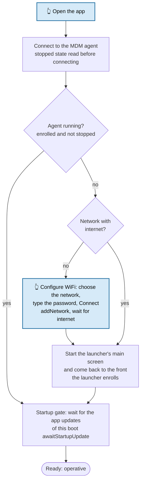

# Ingenico Sample App

`ingenico-app/` (`com.mooney.mdm.ingenico`): an app which brings an Ingenico terminal from the factory state to operative by itself. The user only opens it (and, with no network, chooses the WiFi network and types its password). It shows how an app such as a payment app can do the whole initialization; the [sample app](../README.md) instead has one button per step.

Needs MDM launcher **6.54** or later (before its enrollment the launcher keeps its startup update open, see [Startup sync](startup-sync.md)).

## What it does at start



- **Agent not running**: the launcher is not enrolled (`ERROR_NOT_CONFIGURED`, new device), or it is in the stopped state (never run, or force-stopped: it missed the boot). The app initializes the device: WiFi if needed, then it starts the launcher's main screen, which enrolls it (if needed) and runs its startup update.
- **Agent running**: nothing to start; the app goes straight to the startup gate.
- **Startup gate**, in both cases: the app waits until the launcher has installed the app updates of this boot, because installing an app kills it; it shows the downloads and installs. The gate always opens (end of the startup update, or a timeout).
- **Ready**: server and device number. If the app initialized the agent, it reconnects to read the data of the enrolled launcher.

## WiFi

With `WifiManager.addNetwork()`: the app targets **SDK 28**, the only way Android 10 allows it to an ordinary app (see [WiFi setup](wifi-setup.md#addnetwork-from-an-app-targeting-sdk-28)). No prompt, no reboot, any signing key. The network belongs to the app: Android removes it if the app is uninstalled. Whether production terminals accept an app targeting SDK 28 is still to be confirmed.

The WiFi screen lists the access points nearby (strongest first, **Scan** searches again); WPA/WPA2 personal and open networks. From the ready screen, **Configure WiFi** opens it again (with **Cancel**).

## Ready screen

| Button | What it does |
|---|---|
| **Get device number** | Reconnects to the MDM agent, which reads its configuration again, and shows the server and device number. |
| **Change device number** | Asks the MDM server username and password, a new device number and/or groups (comma-separated, empty = unchanged), and updates the device through the server's REST API (`mdmlib`, `MdmService.changeDevice()`), like the sample app. On a rename the server sends the device a `configUpdated` push; when the launcher has reloaded its configuration, the app reads the device number again. The password is never logged. |
| **Sync configuration** | Asks the launcher to load its configuration now (`forceConfigUpdate()`); waits for its `configUpdated` broadcast, at most 90 s. |
| **Configure WiFi** | The WiFi screen. |

## Tested on the EX6000 (development terminal)

Launcher 6.54 and the app installed through adb, never run; no saved network in range:

| Time | Event |
|---|---|
| 19:31:05 | App opened: `MDM agent not running (not enrolled)`, `No network: configure WiFi` |
| 19:31:35 | Network chosen, password typed, **Connect**: `network RUT200_FA74 added` |
| 19:31:39 | Connected with internet; the app starts the launcher and comes back to the front; startup gate waiting |
| 19:31:41 | Launcher: enrolled, `Configuration updated` |
| 19:31:42–52 | Startup update installs `com.hmdm.pager` and `com.mooney.mdm.sample`; the app shows the progress |
| 19:31:53 | `Startup update completed`, the app: `Operative`, device number shown |

Started again with the agent running: `MDM agent running`, gate open at once, operative.

To be started by the launcher at boot, and to be installed by it, add the app to the configuration on the MDM server (*Run at boot*) and upload its APK.

## Build

```bash
./gradlew :ingenico-app:assembleDebug
```

APK: `ingenico-app/build/outputs/apk/debug/ingenico_sample_app-<version>-debug.apk`. Signed with the launcher's key when the `RELEASE_M10_*` properties are set in `~/.gradle/gradle.properties`, otherwise with the debug key. It uses the hmdm library of the sample app (`app/libs/hmdm-1.2.2.aar`) and `mdmlib`; not the Ingenico USDK.
