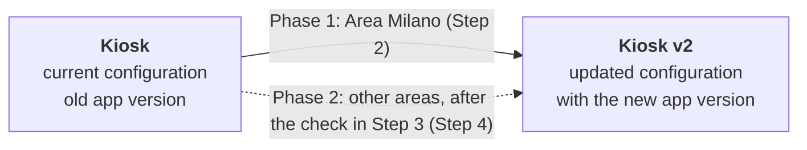

# Staged configuration rollout by area

To release an update, the MDM operator prepares an updated configuration, moves one area's devices to it first, and moves the other areas later. Devices are picked by their area group, which the app sets when each device is set up.

## Before you start

- [ ] The area groups exist in **Groups** (e.g. "Area Milano") and the devices were assigned to them during setup.
- [ ] **Devices** → group filter → "Area Milano" shows the expected devices, all on the current configuration (here "Kiosk").
- [ ] The new APK is uploaded in **Applications** as a new version of the app, with **Auto Update** unchecked. With Auto Update on, every configuration that has the app is updated, which skips the staged rollout.

## Step 1 – Create the updated configuration

1. **Configurations** → "Kiosk" → **Copy** → new name "Kiosk v2".
2. Open "Kiosk v2" → **Applications** tab → find the app. Click **Upgrade** under its version, or click the version and pick the new one.
3. Make any other changes the update needs, then **Save**.

No device uses "Kiosk v2" yet, so nothing changes on the devices. "Kiosk" stays as it is.

## Step 2 – Roll out to the first area

1. **Devices** → group filter → "Area Milano".
2. Tick the select-all box in the table header.
3. Bulk actions → **Set configuration** → "Kiosk v2" → **Save**.
4. Select-all only covers the current page (50 devices). Repeat steps 2–3 on every page.

Each device gets a push, loads "Kiosk v2" and installs the new version.

## Step 3 – Check the first area

- [ ] **Devices** → filter "Area Milano": every device shows configuration "Kiosk v2".
- [ ] Open the application status of a few devices: the app is on the new version, not marked *version mismatch* or *not installed*.
- [ ] Devices that were offline update when they next connect. Check them again later.
- [ ] Collect feedback from the area for the agreed trial period before going on.

## Step 4 – Roll out to the other areas

Repeat Step 2 for each remaining area group, one area at a time or several together. Then check each area as in Step 3.

To find what is left, set both filters: the area group and configuration "Kiosk". To move all the remaining devices at once, set only the configuration filter to "Kiosk".

## Step 5 – Close the rollout

- [ ] No device is left on "Kiosk" (Devices list, configuration column).
- [ ] New devices are enrolled with the **QR code** of "Kiosk v2". The QR code chooses the configuration a new device starts on.
- [ ] Keep "Kiosk" until the rollout is confirmed, so you can roll back. Then delete it or keep it as the base for the next update.

## Rolling an area back

Filter **Devices** by the area group, select all and use **Set configuration** → "Kiosk". The configuration settings return to the old ones at once.

The app itself may stay on the new version. Android usually refuses to install an older version over a newer one, so try the rollback on one device first. If the old version does not come back, release a fixed build in "Kiosk v2" instead.
