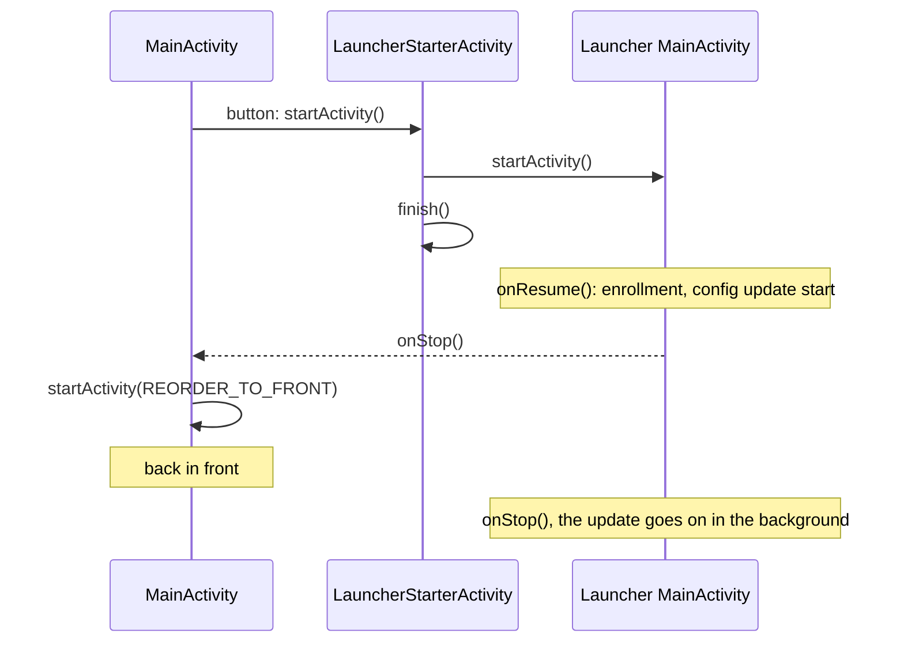

# Starting the MDM launcher and staying in front

How the sample app's **Start MDM launcher** button starts the Headwind MDM launcher, takes it out of the stopped state, and brings the sample app back to the front.

## Why

A launcher that was force-stopped (`adb shell am force-stop`, *Force stop* in the system settings) or just installed and never run is in the **stopped state**: it doesn't receive broadcasts, not even `BOOT_COMPLETED`, so its services don't run and it doesn't do the startup update. Android clears the stopped state only when one of its components is started explicitly.

The launcher does its startup work in its main activity (`com.hmdm.launcher.ui.MainActivity`): it reads the enrollment settings (`init.json`), chooses the device ID and starts the configuration update. Binding to its plugin service is not enough: the service starts, but nothing gets enrolled or updated. So the button starts the launcher's activity, which comes to the front, and the sample app then has to bring itself back.

## How it works

Two pieces:

1. **Come back at the right moment.** When the launcher's activity comes up, Android calls the launcher's `onResume()` first and only then the sample `MainActivity`'s `onStop()`. By the time `onStop()` runs, the launcher has already started its enrollment and configuration update, and they go on in the background. So, if the button set a flag, `onStop()` brings the sample app back:

   ```java
   startActivity(new Intent(this, MainActivity.class)
           .addFlags(Intent.FLAG_ACTIVITY_REORDER_TO_FRONT));
   ```

   `FLAG_ACTIVITY_REORDER_TO_FRONT` brings back the existing screen instead of creating a new one.

2. **Get past the background activity start limit.** In `onStop()` the sample app is in the background. Android 10+ lets a background app start an activity only within **10 seconds** after one of its own activities was started or finished; otherwise the start is silently refused (the activity gets the intent, but its task stays behind). So the button doesn't start the launcher directly:

   1. it opens `LauncherStarterActivity`, an invisible activity of the sample app (translucent theme, not exported, excluded from Recents);
   2. that activity starts the launcher and finishes at once;
   3. one of the sample app's activities has just started and finished, so when `MainActivity.onStop()` runs, a moment later, Android lets it come back.



If the launcher fails to start, `MainActivity` is resumed without `onStop()`, and `onResume()` clears the flag, so a later Home press doesn't bring the app back.

## On the device

Events log of a test on the Ingenico EX6000 (Android 10), clean install of both apps, launcher never run (`adb logcat -b events`):

| Time | Event |
|---|---|
| 44.275 | `LauncherStarterActivity` created |
| 44.359 | launcher `MainActivity` created |
| 44.368 | `LauncherStarterActivity` finished |
| 44.521 | sample `MainActivity.onStop()`: asks to come back |
| 44.924 | launcher `onResume()`: reads `init.json`, starts the configuration update |
| 44.964 | sample `MainActivity` resumed, in front |
| 45.702 | launcher `onStop()` |
| 47.163 | sample app: startup gate open, startup update over |

The launcher's screen is never really seen, and it finishes its update in the background.

## Limits

- It relies on the 10-second rule of Android 10. Android 14+ restricts background activity starts further, so there the launcher may stay in front.
- If the launcher needs the user at its first start (a permission request, the device ID dialog), that dialog ends up behind the sample app. On the Ingenico terminals the device ID comes from the USDK serial number, so no dialog is shown.
- A launcher just installed has no configuration: the sample app shows "MDM launcher not configured yet". Once the launcher is enrolled, press **Get device number** to reconnect and read the server and device number (the hmdm library doesn't query the configuration again by itself).

## Code

- `app/src/main/java/com/rch/mdm/sample/MainActivity.java`: `startLauncher()`, `launcherIntent()`, `onStop()`, `onResume()`
- `app/src/main/java/com/rch/mdm/sample/LauncherStarterActivity.java`
- `app/src/main/AndroidManifest.xml`: the `LauncherStarterActivity` declaration and the `<queries>` for the launcher packages
