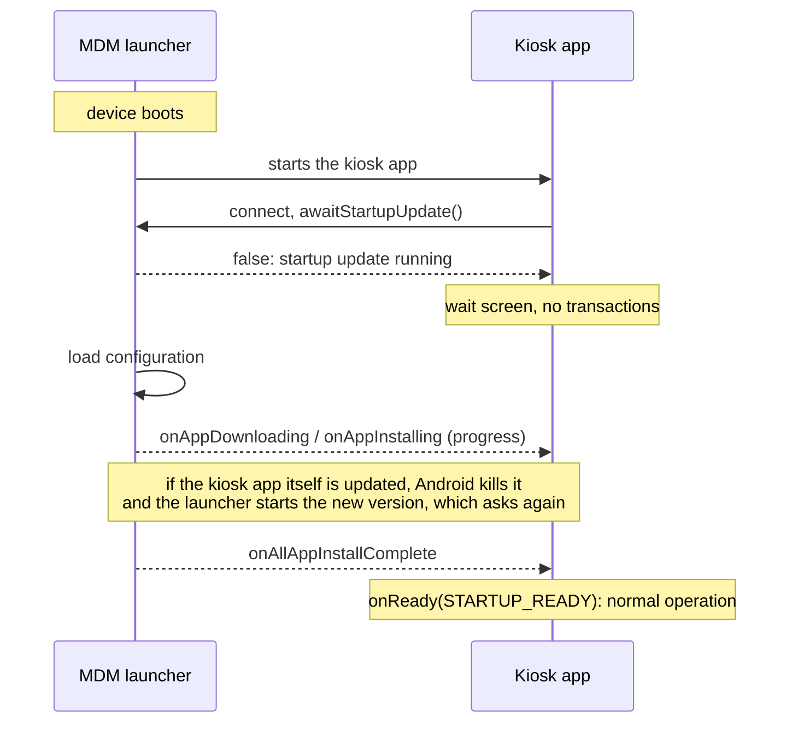

# Startup sync with the MDM launcher

How a kiosk app waits for the Headwind MDM launcher to finish its app updates before it lets the user work.

## Why

When the launcher installs a new version of an app, or removes it, Android kills the app's process. If that happens in the middle of a payment, the payment is lost.

So the launcher installs and removes apps **only during the startup update**: the first configuration update after the device boots. Configuration updates later in the day (push, the periodic check, the update button, plugin calls) apply everything else (settings, policies, files, remote commands) but leave app installs and removals for the next boot. This is on by default and can be turned off per configuration (see [Configuration option](#configuration-option)).

At boot the kiosk app may already be running while the launcher installs updates (the launcher starts the kiosk app as soon as it starts). The kiosk app therefore asks the launcher whether the startup update is over and waits until it is: the **startup gate**. While it waits it is idle, so if the launcher replaces it, nothing is lost.

## How it works



What the launcher guarantees:

- **The gate always opens.** The launcher reports the end of the startup update when the apps are updated, when the configuration can't be loaded (server or network error), or after **3 minutes**. At the timeout, an app download or installation already running gets up to 20 more seconds to finish; the app updates not started yet are left for the next boot, and nothing is installed or removed after the gate opens.
- **Once per boot.** After the startup update, `awaitStartupUpdate` answers "over" until the next boot, even if the launcher restarts (crash, or the launcher updating itself).
- **No app changes during the day** (unless turned off in the configuration). Outside the startup update, the launcher doesn't install or remove apps, so a running app is never killed by an update.

The library adds its own timeout of **3 minutes 30 seconds** as a safety net, for example when the launcher doesn't answer at all. It is longer than the launcher's, so normally the launcher decides.

## Requirements

- Headwind MDM library (`hmdm`) **1.2.0** or later: `app/libs/hmdm-1.2.0.aar` in this project.
- MDM launcher with plugin API version **120** or later (`HeadwindMDM.getVersion()`). An older launcher doesn't support the startup sync: the gate opens immediately (`STARTUP_READY`), as there's no information to wait for.
- The launcher package must be visible to the app (Android 11+):

```xml
<queries>
    <package android:name="com.hmdm.launcher" />
</queries>
```

## Integration

Put the gate in the app's **launch activity** (the one with the `MAIN`/`LAUNCHER` intent filter, which the launcher starts in kiosk mode). Keep everything which must not be interrupted disabled until `onReady()`.

```java
public class MainActivity extends AppCompatActivity implements HeadwindMDM.EventHandler {

    private HeadwindMDM headwindMDM;

    @Override
    protected void onCreate(Bundle savedInstanceState) {
        super.onCreate(savedInstanceState);
        setContentView(R.layout.activity_main);
        // ... find views, keep the transaction UI disabled ...

        headwindMDM = HeadwindMDM.getInstance();
        if (!headwindMDM.isConnected()) {
            headwindMDM.connect(this, this);
        }

        // After connect(): if connect() failed, onReady(STARTUP_NO_MDM) is called right away
        headwindMDM.awaitStartupUpdate(new HeadwindMDM.StartupGateListener() {
            @Override public void onWaiting() {
                showWaitScreen("Device updating, please wait");
            }

            @Override public void onAppDownloading(String pkg, String name) {
                showWaitScreen("Downloading " + name);
            }

            @Override public void onAppInstalling(String pkg, String name) {
                showWaitScreen("Installing " + name);
            }

            @Override public void onReady(int reason) {
                hideWaitScreen();
                enableTransactions();
            }
        });
    }
    // ...
}
```

`StartupGateListener` methods, all called on the main thread:

| Method | When |
|---|---|
| `onWaiting()` | The startup update is running. Show a wait screen. May be called again after a reconnection. |
| `onAppRemoving(pkg, name)`, `onAppDownloading(pkg, name)`, `onAppInstalling(pkg, name)` | Progress of the app updates. Optional. |
| `onDownloadProgress(progress, total, current)` | Download progress of the current app (`progress` in %). Optional. |
| `onReady(reason)` | **Required.** The app may start working. Called once per `awaitStartupUpdate` call. |

`onReady` reasons:

| Reason | Meaning |
|---|---|
| `HeadwindMDM.STARTUP_READY` | The startup update is over, or the launcher is too old to support the startup sync. |
| `HeadwindMDM.STARTUP_TIMEOUT` | The launcher didn't answer within the library timeout. |
| `HeadwindMDM.STARTUP_NO_MDM` | The launcher isn't installed, or `connect()` failed. |

All reasons mean "start working": the gate is a protection, never a reason for the app to stay blocked. To use a different safety-net timeout, call `awaitStartupUpdate(listener, timeoutMs)`; keep it longer than the launcher's 3 minutes.

The complete example is in [`MainActivity.java`](../app/src/main/java/com/rch/mdm/sample/MainActivity.java) of the sample app (`awaitStartupUpdate()`).

## Rules for the app

1. **Nothing which must not be interrupted before `onReady()`**: no payments, no writes which leave data half done. Reading data and showing a screen is fine.
2. **Call it on every start of the launch activity**, not only at boot. After boot the answer comes back immediately, so it costs nothing, and the app doesn't have to know whether it was started by a boot.
3. **Expect to be killed while waiting.** If the launcher updates the app, the process dies and the launcher starts the new version, which calls `awaitStartupUpdate` again and gets "over" at once. Don't save anything while waiting that a kill would leave half done.
4. **Don't wait in a boot receiver.** Since Android 10 an app can't start an activity from the background, so a `BOOT_COMPLETED` receiver which opens the app's UI doesn't work reliably. In kiosk mode the launcher starts the app after boot; the gate in the launch activity covers that start. If the app has a boot receiver for other work (for example to start a service), that work must follow the same rule 1, or wait for the gate too.
5. **Don't call `forceConfigUpdate()` to "speed up" the startup update**: it starts a second configuration update in parallel. During the day it updates the configuration but doesn't install apps.

## Lower-level API

`HeadwindMDM.awaitStartupUpdate` handles the connection, reconnections and the timeout. Apps which use `MDMService` directly can call:

```java
// true: the startup update is over (or the launcher is older than API 120)
// false: the listener receives the progress and finally onAllAppInstallComplete()
boolean over = MDMService.getInstance().awaitStartupUpdate(configUpdateListener);
```

The app must then handle the timeout and reconnections itself (the launcher restarts when it updates itself, and the registered listener is lost).

## Configuration option

Whether app changes wait for the next boot is a configuration setting, sent by the server in the configuration JSON:

| Key | Values | Default |
|---|---|---|
| `appUpdateAtStartupOnly` | `true`: app installs and removals only during the startup update. `false`: also during the day, right after a configuration update (the app may be killed while in use). | `true` when the key is missing |

The current server doesn't send this key yet, so all devices use the default (`true`). To make it editable, the server needs a field in the configuration (for example a checkbox "Install app updates only at device startup", checked by default) sent as `appUpdateAtStartupOnly` in the device configuration.

With either value, the startup update and the startup gate work the same way: the gate is still needed, because the startup update installs apps right after boot.

## Operator notes

- In the configuration, app updates are released as usual (new version, action **Install**). With the default setting, devices install them **at the next boot**, not when the configuration is saved. To apply an update right away, reboot the device (from the web panel or by hand).
- The configuration's app update time window and "WiFi only" option still apply to the startup update. If a device boots outside the window, its app updates wait for the next boot within the window.
- The launcher writes `N app update(s) deferred to the next boot` in the device log when a configuration update during the day skips app changes.

## Testing

Device connected with `adb`. Launcher log: `adb logcat -s HeadwindMDM`.

| Test | Steps | Expected |
|---|---|---|
| Update pending at boot | Release a new version of the kiosk app in the configuration, then `adb reboot`. | The app shows the wait screen, the launcher installs the new version, the new version starts and opens the gate (`STARTUP_READY`). |
| Nothing to update | `adb reboot` with no change in the configuration. | The gate opens within a few seconds. |
| Update during the day | Release a new version without rebooting (default setting). | The running app isn't killed; the log shows `app update(s) deferred to the next boot`; the update is installed at the next reboot. |
| No network at boot | Disable WiFi / mobile data, `adb reboot`. | The gate opens after the launcher gives up loading the configuration (at the latest after 3 minutes). |
| App restart | Close and reopen the app during the day. | The gate opens immediately. |
| Old launcher | Install a launcher with API version below 120. | The gate opens immediately (`STARTUP_READY`). |
