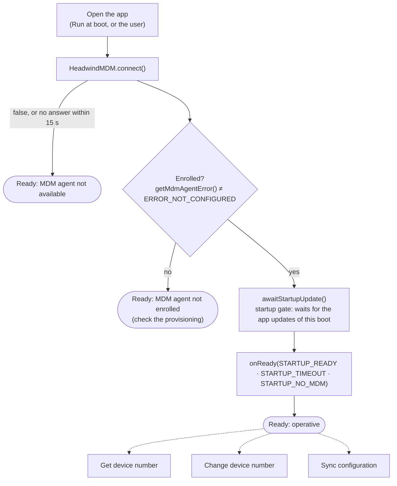

# Sunmi Sample App

`sunmi-app/` (application ID `com.mooney.mdm.sunmi`) is the Sunmi counterpart of the [Ingenico Sample App](ingenico-sample-app.md). When it is opened, it waits for the MDM launcher to install the app updates of this boot, then it is operative.

It is much simpler than the Ingenico app, because on Sunmi terminals:

| Ingenico | Sunmi |
|---|---|
| The launcher (`com.hmdm.launcher.ingenico`) is neither device owner nor HOME app: nothing starts it at boot if it is in the stopped state | The launcher (`com.hmdm.launcher`) is **device owner** and the **HOME app**: Android starts it at every boot, it is never left in the stopped state |
| The app starts the launcher's main screen, which enrolls it | The provisioning procedure (adb, `init.json`, `dpm set-device-owner`) has already enrolled the launcher |
| The app configures WiFi when there is no network (targets SDK 28 for `addNetwork`) | The network is already set up: no WiFi setup, normal targetSdk |

## Requirements

| What | Why |
|---|---|
| MDM launcher `com.hmdm.launcher`, device owner, enrolled | Set up by the provisioning procedure |
| Network already set up | The app doesn't configure it |
| hmdm library 1.2.3 (`app/libs/hmdm-1.2.3.aar`) | Connection to the launcher and startup gate |
| `mdmlib` (this repository) | Only for **Change device number** |

## Deployment

On the MDM server, add `com.mooney.mdm.sunmi` to the terminal's configuration with its APK and either set it as the **kiosk app** (kiosk mode on: the launcher starts it at every boot right away, before the startup update ends) or mark it **Run at boot** (kiosk mode off: the launcher opens it at every boot once the startup update is over). The launcher installs it with the first startup update. See [Boots after the enrollment](#boots-after-the-enrollment).

## What the app does



When the launcher is not enrolled the app doesn't wait at the gate: with launcher 6.54 or later the startup update stays open until the enrollment, and only the provisioning procedure can enroll it.

The operative screen has the same **Get device number**, **Change device number** and **Sync configuration** buttons as the Ingenico app (no **Configure WiFi**).

## Boots after the enrollment

What the app has to do at every boot once the launcher is enrolled. Steps **L** are the launcher's, for context: the app does nothing in them. Steps **A** are the app's. Order and times as traced on LE15P5CS00214 (launcher 6.60-master, kiosk mode, this app as the kiosk app, no app to install in that boot); the launcher side is in [Boot and enrollment flow](launcher-boot-enrollment.md#sunmi-boot-sequence).

The app is started either as the **kiosk app** (kiosk mode on, the usual case) or by ***Run at boot*** (kiosk mode off). The difference for the app is only when it starts: before the startup update ends (kiosk) or after it (*Run at boot*). The app's steps are the same.

### Normal boot, kiosk mode

**Launcher (context: the app does nothing)**

- **L1 – The terminal boots.** After the user unlock, Android opens the HOME app: the launcher's `MainActivity` (3 s after the unlock). `BOOT_COMPLETED` comes later, and the launcher's `BootReceiver` ignores it (`already started`).
- **L2 – Startup update begins** (`Updating configuration in startLauncher()`): the launcher requests the configuration and will install the updated apps.
- **L3 – Kiosk start, right away:** lock task mode first (`Lock task mode started in 810 ms`), then the kiosk app, in front. **The startup update is still running.**
- **L4 – The startup update goes on** while the app waits: configuration loaded (here after waiting 8 s for the WiFi), app downloads and installs. At the end the launcher doesn't start the kiosk app again (`Kiosk mode running, launcher in background: … not restarted`).
- **L5 – Startup update over** (`Startup update completed`): the gate opens.

**App (what it has to do)**

- **A1 – `headwindMDM.connect()`.**
- **A2 – In `onHeadwindMDMConnected()`, check that the agent is enrolled:** `getMdmAgentError() != ERROR_NOT_CONFIGURED`. Expected: enrolled. No stopped check and no `startLauncher()`: the launcher is the HOME app, Android has started it (L1).
- **A3 – Call `awaitStartupUpdate()`.** Expected: **the startup update is running** (`onWaiting()`): show a wait screen, no transactions. The listener receives the progress: `onAppRemoving`, `onAppDownloading`, `onDownloadProgress`, `onAppInstalling`.
- **A4 – Wait for `onReady()`:** it arrives at L5 with `STARTUP_READY`. Handle `STARTUP_TIMEOUT` and `STARTUP_NO_MDM` the same way: they all mean "start working".
- **A5 – Go on with the app's workflow.** No reconnection is needed: the app didn't start the launcher, so the data read in A2 is already from after the enrollment.

In the traced boot the app connected at 15:30:16.9 and the gate opened at 15:30:30.7: **14 s at the gate**, mostly waiting for the WiFi (the first configuration request failed, the second one at 15:30:26 succeeded).

### Normal boot, kiosk mode off (*Run at boot*)

As on Ingenico: the launcher runs the whole startup update first, and **5 s after its end** starts the apps marked *Run at boot* (on Sunmi the launcher's main screen is open, as the HOME app, so the 1 s pause of launcher 6.62 on Ingenico doesn't apply). A1–A2 as above, **A3** answers at once that the startup update is over (no events), **A4** `onReady(STARTUP_READY)` arrives at once, **A5**.

### Variants

**A. No network at boot.** The configuration request is retried (6 times, every 10 s); in the traced boot the launcher also waited for the network before retrying. If it still fails, the launcher ends the startup update (`Startup update failed: network error`) with the configuration of the previous boot, and the app updates wait for the next boot. **For the app, A1–A5 don't change**: the gate opens at the end, `onReady()` arrives.

**B. Long startup update** (many apps, slow downloads). The app stays in A3 with the progress events. The gate opens at the end, or after the **3 min** timeout (an install already running gets 20 s more; the updates not started yet wait for the next boot). The library has its own safety timeout of 3.5 min, after which `onReady(STARTUP_TIMEOUT)` arrives anyway.

**C. The startup update installs a new version of the app.** In kiosk mode the app is already running (L3), so **Android kills it** during the install, while it waits at the gate. Lock task mode brings the launcher back in front, and the launcher starts the kiosk app again: the new version starts from A1. If other apps are still being updated it waits in A3, otherwise A3 answers at once. Nothing the app has to handle, except that the work done before `onReady()` is lost: that's why the app must not start transactions before A4. With kiosk mode off, the app isn't open during the update (*Run at boot* comes after), so it isn't killed.

**D. Launcher not enrolled** (provisioning not done or failed). A2 finds `ERROR_NOT_CONFIGURED`: the app **doesn't wait at the gate** (with launcher 6.54 or later it stays open until the enrollment) and shows "MDM agent not enrolled". Only the provisioning procedure can enroll the launcher (see [Boot and enrollment flow](launcher-boot-enrollment.md#sunmi-first-enrollment)).

**E. Later in the day**, when the user reopens the app or the app restarts (also after a crash: in kiosk mode the launcher starts it again within a fraction of a second): A1–A2 as above, A3 answers at once (the "over" state lasts for the whole boot), and the launcher doesn't install or remove apps until the next boot.

### Differences from the Ingenico app

| | Ingenico | Sunmi |
|---|---|---|
| Who starts the launcher at boot | A broadcast (`BOOT_COMPLETED`, SIM change) | Android, as the HOME app |
| Who starts the app | *Run at boot*, after the startup update | Kiosk mode, **before** the end of the startup update (or *Run at boot*, after it, with kiosk mode off) |
| Stopped check before `connect()` | Yes (launcher force-stopped: it misses the boot) | No: Android starts the HOME app again |
| `startLauncher()` | When not enrolled or stopped | Never |
| Startup gate | Usually already open | Usually **waits** (kiosk mode) |
| Reconnection after `onReady()` | Yes (`disconnect()` + `connect()`) | Not needed |

## Build

```
./gradlew :sunmi-app:assembleRelease
```

APK: `sunmi-app/build/outputs/apk/release/sunmi_sample_app-<version>-release.apk`. It is signed with the launcher's key when `RELEASE_M10_*` is set in `~/.gradle/gradle.properties`, otherwise with the debug key; the app needs no special signature.
