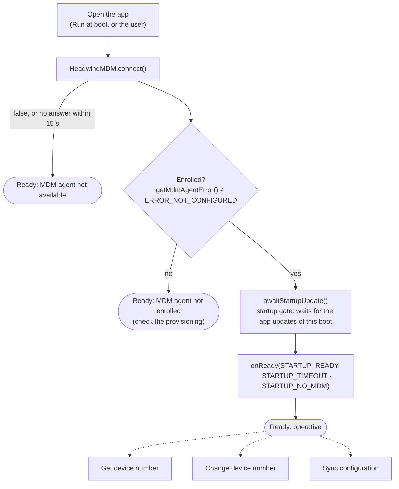

# Sunmi Sample App

`sunmi-app/` (application ID `com.mooney.mdm.sunmi`) is the Sunmi counterpart of the [Ingenico Sample App](ingenico-sample-app.md). When it is opened, it waits for the MDM launcher to install the app updates of this boot, then it is operative.

It is much simpler than the Ingenico app, because on Sunmi terminals:

| Ingenico | Sunmi |
|---|---|
| The launcher (`com.hmdm.launcher.ingenico`) is neither device owner nor HOME app: nothing starts it at boot if it is in the stopped state | The launcher (`com.hmdm.launcher`) is **device owner** and the **HOME app**: Android starts it at every boot, it is never left in the stopped state |
| The app starts the launcher's main screen, which enrolls it | The provisioning procedure (adb, `init.json`, `dpm set-device-owner`) has already enrolled the launcher |
| The app configures WiFi when there is no network (targets SDK 28 for `addNetwork`) | The network is already set up: no WiFi setup, normal targetSdk |

## Requirements

| What | Why |
|---|---|
| MDM launcher `com.hmdm.launcher`, device owner, enrolled | Set up by the provisioning procedure |
| Network already set up | The app doesn't configure it |
| hmdm library 1.2.3 (`app/libs/hmdm-1.2.3.aar`) | Connection to the launcher and startup gate |
| `mdmlib` (this repository) | Only for **Change device number** |

## Deployment

On the MDM server, add `com.mooney.mdm.sunmi` to the terminal's configuration with its APK and mark it **Run at boot**: the launcher installs it with the first startup update and opens it at every boot once the startup update is over.

## What the app does



When the launcher is not enrolled the app doesn't wait at the gate: with launcher 6.54 or later the startup update stays open until the enrollment, and only the provisioning procedure can enroll it.

The operative screen has the same **Get device number**, **Change device number** and **Sync configuration** buttons as the Ingenico app (no **Configure WiFi**).

## Build

```
./gradlew :sunmi-app:assembleRelease
```

APK: `sunmi-app/build/outputs/apk/release/sunmi_sample_app-<version>-release.apk`. It is signed with the launcher's key when `RELEASE_M10_*` is set in `~/.gradle/gradle.properties`, otherwise with the debug key; the app needs no special signature.
