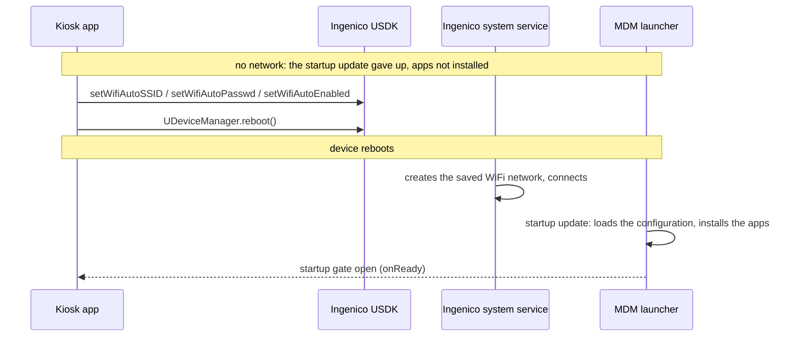
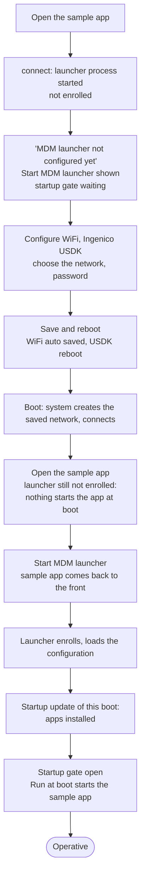
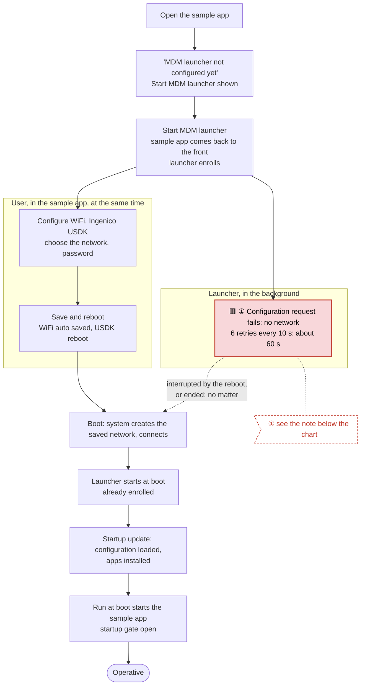
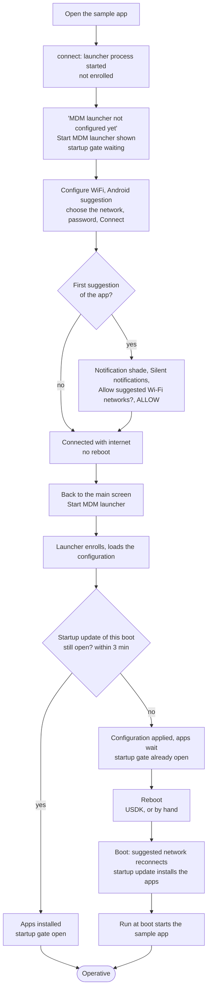

# WiFi setup on Ingenico terminals

How an app configures the WiFi network of an Ingenico terminal without the system settings. There are two methods, each with its own trade-offs: **Ingenico "WiFi auto"** through the USDK, and Android **network suggestions**. This document describes both, when each needs a reboot or a configuration sync request to the MDM launcher, the [procedures](#procedures-from-a-new-device-to-operative) from a new device to an operative one (and why not to start the launcher first), and what sync requests are available.

## Why

A terminal fresh from the factory has the MDM launcher and the kiosk app installed, but no network: the launcher can't load its configuration, so it can't install the other apps or apply the settings. The network has to be configured from the kiosk app, without sending the user to the system settings.

## What Android allows

On Android 10 (Ingenico EX6000) an ordinary app can no longer add a WiFi network silently. Tested on the EX6000 with an app targeting SDK 34, not device owner (Ingenico's `com.ingenico.dxmobile` is) and not a system app:

| Way | Result |
|---|---|
| `WifiManager.addNetwork()` / `enableNetwork()` | Refused (`addNetwork` returns -1): only device owner and system apps may use them with targetSdk 29+. |
| `WifiNetworkSpecifier` | The connection belongs to the app only: the launcher can't use it to reach the server. |
| Settings WiFi panel | Works, but it is the system settings screen. |
| **Ingenico USDK "WiFi auto"** | **Works**: connects at the next boot. See [Ingenico WiFi auto](#ingenico-wifi-auto). |
| **`WifiManager.addNetworkSuggestions()`** | **Works**: connects right away, once the user allows it. See [Network suggestions](#network-suggestions). |

## The two methods

| | Ingenico WiFi auto | Network suggestions |
|---|---|---|
| API | Ingenico USDK `UNetWorkManager` | Android `WifiManager.addNetworkSuggestions()` |
| Devices | Ingenico terminals | any Android 10+ device |
| Signing key | Ingenico-approved | any |
| User action | none | **Allow** in a silent notification, once per app |
| Connection | at the next boot: the app reboots the device | right away, a few seconds after the approval |
| Network | ordinary saved network, stays without the app; recreated at every boot while WiFi auto is on | belongs to the app (`ephemeral`, `fromWifiNetworkSuggestion`), removed with the app; kept across reboots |
| Launcher configuration | loaded by the startup update at the reboot: no sync request | the launcher has usually given up its startup update: a sync request loads it |
| Apps of the configuration | installed by the startup update at the reboot | installed at the next boot (a reboot right away installs them) |

Choose by what fits the deployment: WiFi auto needs no user action but needs the Ingenico key and a reboot; suggestions work with any key and without a reboot but need the user to find and allow the notification (on a kiosk terminal the notification shade may be locked).

## Ingenico WiFi auto

The Ingenico USDK network manager (`UNetWorkManager`, module `ModuleName.NETWORK_MANAGER`) has a "WiFi auto" setting: a network name and password that Ingenico's system service turns into a saved WiFi network.

```java
UNetWorkManager nm = UNetWorkManager.Stub.asInterface(
        deviceService.getModule(ModuleName.NETWORK_MANAGER, null));
nm.setWifiEnabled(true);
nm.setWifiAutoSSID(ssid);
nm.setWifiAutoPasswd(password);     // WPA/WPA2 personal
nm.setWifiAutoEnabled(true);
```

All calls return 0 on success. The service stores them as `config_wifiauto_SSID` / `config_wifiauto_passwd`.

What happens next:

- **Nothing until the next boot.** Tested: no connection after 60 s, none after turning WiFi off and on.
- **At boot**, while WiFi auto is on, the system service (uid 1000) creates a saved WiFi network with that SSID and password and connects to it. It is an ordinary saved network: it stays if the app is uninstalled.
- **At every boot.** WiFi auto stays on, so the network is recreated at every boot, even after it has been forgotten in the settings. Settings only removes Android's saved network, not Ingenico's setting.
- **To turn it off:** `setWifiAutoEnabled(false)`, and blank the SSID and password (`setWifiAutoSSID("")`, `setWifiAutoPasswd("")`) so the password doesn't stay in the settings. Android's saved network stays (the app can't remove a network created by the system: forget it in the settings).

### Requirements

- **Signing key.** The USDK accepts these calls only from apps signed with an Ingenico-approved key: with it the USDK log shows `isEpayApp: true` and `The permission[titan.extperm.NET_SET] is successfully verified`. The sample app is signed with the launcher's key when the `RELEASE_M10_*` properties are set in `~/.gradle/gradle.properties`; with the debug key the calls fail.
- **USDK library.** `usdk_api_aidl_v13.12.0.20240202.jar` is proprietary and not in this repository: copy it from `app/libs/` of the launcher repo to `app/libs/` (the build says so when it's missing).
- **Manifest:** `titan.extperm.NET_GET` and `titan.extperm.NET_SET`, and `<queries>` for `com.usdk.apiservice`.

### The reboot is necessary

The settings are applied only at boot, so the app must reboot the device after saving them. The USDK can do it, with the same signing key:

```java
UDeviceManager.Stub.asInterface(deviceService.getDeviceManager()).reboot();
```

The MDM launcher's `reboot` push (`HeadwindMDM.sendPush("reboot", null)`) doesn't work here: the launcher reboots only in device owner mode, and on these terminals it isn't device owner.

### After the reboot no sync request is needed

The reboot also solves the configuration of the MDM launcher, without any request from the app:



- **Without the reboot**, the launcher has already given up: at boot it retries loading the configuration 6 times every 10 s, then ends the startup update. From then on, app installs and removals wait for the next boot (*Install app updates only at device startup*, on by default, see [Startup sync](startup-sync.md)). A sync request (`forceConfigUpdate()`) would load the configuration and apply settings and policies, but leave the apps for the next boot.
- **With the reboot**, the network is there when the launcher starts: the **startup update** loads the configuration and installs the apps like on any boot, and the startup gate holds the kiosk app until they're installed. Nothing for the app to request.

On the EX6000, sample app, launcher just installed, no network:

| Time | Event |
|---|---|
| 11:47:50.068 | Sample app: `WiFi: saving network RUT200_FA74` |
| 11:47:50.282 | `WiFi: network saved, rebooting` (USDK reboot) |
| 11:48:56.873 | At boot the system creates the saved network `RUT200_FA74` and connects |
| 11:49:17 | Launcher: `Configuration updated` |
| 11:49:18–24 | Startup update installs `com.hmdm.pager` |
| 11:49:24.687 | `Startup update completed`, the sample app's gate opens |
| 11:49:29.756 | `Run at boot: started com.mooney.mdm.sample` |

In this test the launcher had been installed through adb and never run, so it was in the stopped state and didn't receive the boot broadcast: the **Start MDM launcher** button started it (see [Starting the MDM launcher](start-launcher.md)). A launcher which has already run, or is preinstalled as a system app, starts by itself at boot.

## Network suggestions

`WifiManager.addNetworkSuggestions()` is the Android 10 API for ordinary apps: no USDK, any signing key.

```java
WifiNetworkSuggestion suggestion = new WifiNetworkSuggestion.Builder()
        .setSsid(ssid)
        .setWpa2Passphrase(password)           // omit for an open network
        .setIsAppInteractionRequired(true)     // POST_CONNECTION broadcast to the app
        .build();
int status = wifiManager.addNetworkSuggestions(Collections.singletonList(suggestion));
```

Android 10 refuses a suggestion with the SSID of one the app already made: remove the app's suggestions first (`removeNetworkSuggestions()` with an empty list removes them all).

Tested on the EX6000 with a test app, WiFi auto off, no saved network:

| Step | Result |
|---|---|
| `addNetworkSuggestions()` | Accepted (status 0). Android posts the notification "Allow suggested Wi‑Fi networks?" |
| 60 s without approving | Not connected (`dumpsys wifi`: `Has user approved: false`) |
| Approval | The notification is filed under **Silent notifications**, collapsed: the user has to open the notification shade and expand it to see **Allow** / **No thanks** |
| **Allow** tapped (12:57:21.997) | `Has user approved: true` |
| 12:57:29.946 | Connected, 8 s after Allow (`ACTION_WIFI_NETWORK_SUGGESTION_POST_CONNECTION` to the app) |
| 12:57:30.618 | Validated internet (`NetworkCallback`) |
| Reboot | Connected again at about 67 s uptime, without the app running: approved suggestions are kept |

The approval is asked once per app; later suggestions of the same app connect without it.

### After the connection

The device is connected without a reboot, but the launcher's startup update has usually given up by then (6 retries every 10 s at boot). So:

- **Sync request** (see [Sync request: availability](#sync-request-availability)): the launcher loads the configuration now and applies settings, policies, files and remote commands. If the connection comes while the startup update is still retrying, the startup update loads the configuration itself: don't request a sync then.
- **Reboot**: the startup update at the next boot installs the apps of the configuration. Through the USDK (Ingenico key), or by hand.

The app has to tell the user where the notification is, and wait for the connection (`NetworkCallback` with `NET_CAPABILITY_VALIDATED`).

Android 11 and later also offer `Settings.ACTION_WIFI_ADD_NETWORKS`, a system dialog which saves the network as an ordinary user network; not available on Android 10.

## Procedures: from a new device to operative

The procedures start from the kiosk app (sample app), with WiFi through the Ingenico USDK or through a network suggestion. Starting point:

- the launcher (`com.hmdm.launcher.ingenico`) and the sample app installed, the launcher never run (stopped state);
- no network;
- the sample app marked *Run at boot* in the configuration; *Install app updates only at device startup* on (default).

**Operative** means: WiFi connected, the launcher enrolled with its configuration loaded, the apps of the configuration installed, the sample app's startup gate open.

What decides the steps:

- The launcher **enrolls** (reads its enrollment settings, chooses the device ID) only in its main screen: when it is started by hand or with **Start MDM launcher**. Binding to its plugin service (the sample app's `connect()`) starts its process but doesn't enroll it: the sample app shows "MDM launcher not configured yet".
- The launcher knows which apps to start (*Run at boot*) and install only from its **configuration**, loaded from the server: without a network it has none.
- Apps are installed only by the **startup update**, the first configuration update of a boot. It ends when the configuration is loaded and the apps installed, or when the configuration can't be loaded (6 retries every 10 s, about 60 s), or 3 minutes after it started; after that, apps wait for the next boot.

> 🟥 **Red blocks: about 60 s of delay.** Each is marked ① in the chart and explained by the ① note right below it.

In the charts, the blocks in **red** are where the launcher's configuration retries add about **60 s** (6 retries every 10 s with no network). During them the user can go on (the WiFi screen doesn't wait), but the startup gate stays closed until they end.

### Why not start the launcher first

Starting the MDM launcher first (tapping its icon) on a device without network is not effective:

- **It doesn't start the sample app.** The launcher enrolls, but it can't load its configuration, so it doesn't know the sample app is *Run at boot*: the user still has to go to the home screen and open the sample app by hand to configure WiFi.
- **It adds about 60 s.** Its configuration request is retried 6 times every 10 s before the startup update ends; meanwhile the sample app's startup gate stays closed.
- **With a network suggestion it costs a reboot.** Those failed retries end the startup update before the WiFi is connected: the configuration can then be loaded with a sync request, but the apps wait for the next boot.

The enrollment the launcher needs can be done from the sample app, without leaving it, with **Start MDM launcher**, at the right moment: before **Save and reboot** with the Ingenico USDK ([1, optimized](#1-optimized-wifi-through-the-ingenico-usdk)), after the WiFi connected with a network suggestion ([2](#2-wifi-through-a-network-suggestion)).

### 1. WiFi through the Ingenico USDK



Tested on the EX6000 (see the log in [After the reboot no sync request is needed](#after-the-reboot-no-sync-request-is-needed)), with **Start MDM launcher** pressed 12 s after opening the sample app. Pressed after more than 3 min, the apps would wait for one more reboot: see [Timeouts](#timeouts-what-is-practicable) and the optimized chart.

### 1, optimized: WiFi through the Ingenico USDK



> 🟥 **① About 60 s of delay** (red block ① in the chart), but harmless: the launcher's failed configuration requests run **in the background, in parallel** with **Configure WiFi**. The user doesn't wait for them: **Save and reboot** can be pressed right away, and the reboot simply interrupts them. They only keep the startup gate closed meanwhile. After the reboot nothing waits.

After the reboot no step depends on the user, so no timeout can be missed. With WiFi through the Ingenico USDK, the best procedure is therefore: **Start MDM launcher** first, then **Save and reboot**.

### 2. WiFi through a network suggestion



In this procedure **Sync configuration** is not needed: starting the launcher loads the configuration. The 3 minutes run from the first request of the boot, here the sample app's startup gate.

Procedures 1, optimized, and 2 combine steps tested on the EX6000 one by one (the launcher started without network, the USDK reboot, the suggestion approval and connection); they haven't been run end to end.

### Timeouts: what is practicable

Two launcher timeouts decide whether a procedure installs the apps in the current boot or needs one more reboot (the launcher is left as it is):

| Timeout | Starts | When it expires |
|---|---|---|
| **Configuration retries**: 6 × 10 s, about 60 s | when the enrolled launcher first asks for the configuration in a boot (at boot, or when its main screen enrolls it) | the startup update ends without configuration; the startup gate opens; apps wait for the next boot |
| **Startup update**: 3 min | at the first request of the boot to the startup update: the kiosk app's startup gate (`awaitStartupUpdate`), or the launcher's own update | the startup update ends; apps wait for the next boot |

Both are counted once per boot, and the WiFi screen doesn't wait for either: it can be used while the startup gate is still closed.

| Procedure | As charted | Timeout | Optimized |
|---|---|---|---|
| 1. USDK | **At risk** | After the reboot the sample app's startup gate starts the 3 min (the launcher, not enrolled, does nothing at boot). If **Start MDM launcher** is pressed later than 3 min after opening the sample app, the startup update has expired: configuration loaded, apps wait, one more reboot. | **Start MDM launcher before Save and reboot** ([1, optimized](#1-optimized-wifi-through-the-ingenico-usdk)): after the reboot the launcher starts by itself, and its startup update loads the configuration and installs the apps with no user action. |
| 2. Suggestion | **Practicable within 3 min** of opening the sample app | The 3 min start when the sample app opens (its startup gate). WiFi, approval and **Start MDM launcher** must all fit in them. Starting the launcher **before** the WiFi connects is worse: its 60 s retries fail and end the startup update. | Order: open the sample app → **Configure WiFi** → **Connect** → **Allow** → **Start MDM launcher**, without pauses. Past 3 min: reboot, as charted. |

## Network list

Both methods can show the access points nearby. `WifiManager.getScanResults()` on Android 10 needs the location permission and the location turned on. The Ingenico firmware grants the permission at install (`GRANTED_BY_DEFAULT`). Android lets an app scan about 4 times every 2 minutes.

## Sync request: availability

The launcher (plugin API, any version since 1.1.5) loads the configuration from the server on request; no API key is needed. Useful after a network suggestion connected, or when settings changed on the server during the day.

| API | Since | Reports |
|---|---|---|
| `HeadwindMDM.forceConfigUpdate()` | library 1.1.5 | Only whether the request reached the launcher (`getMdmAgentError()`). The launcher then sends the `com.hmdm.push.configUpdated` broadcast at the end of a **successful** update (`onHeadwindMDMConfigChanged()`); nothing on errors. |
| `MDMService.getInstance().forceConfigUpdate(ConfigUpdateListener)` | launcher API 119 (1.1.9) | Progress and result through the listener, on the main thread: `onConfigLoaded()`, `onConfigUpdateComplete()`, `onConfigUpdateError(type, text)` (1 = server, 2 = network, after the retries), app download and install events. Throws `MDMException(ERROR_VERSION)` with an older launcher. |

Rules:

- **Not during the startup update:** it would start a second configuration update in parallel. Call it after the startup gate opened (`onReady()`).
- **During the day** (default configuration option) it applies settings, policies, files and remote commands, but app installs and removals wait for the next boot.
- On a network error the launcher retries 6 times every 10 s before giving up.

The sample app's **Sync configuration** button uses `HeadwindMDM.forceConfigUpdate()`: it is shown once the startup gate is open, and shows "Syncing configuration, please wait" until the launcher's `configUpdated` broadcast, or for at most 90 s, because the launcher sends nothing when the update fails. `ConfigUpdateListener` would report the errors as well.

## Sample app

- **Configure WiFi** (main screen, always shown, not tied to the startup gate): setup method, list of access points, network name, password. The chosen method is saved (the first time, Ingenico USDK is selected):
  - **Ingenico USDK**: **Save and reboot** saves the network in WiFi auto and reboots through the USDK.
  - **Android suggestion**: **Connect** suggests the network and tells the user where to allow it (notification shade, *Silent notifications*, *Allow suggested Wi‑Fi networks?*, **ALLOW**). When the device is connected with internet the screen offers **Sync configuration** (the main screen requests the sync and waits for it; skipped while the launcher's startup update is still running) and **Reboot** (through the USDK, so the startup update installs the apps). Open networks are allowed (empty password).
  - Where the USDK is not available or refuses the calls (signing key), only the Android suggestion can be selected.
- **Reset WiFi setup** (same screen): removes the app's suggestions and turns WiFi auto off, clearing its network and password. To reproduce a device fresh from the factory: press it, then forget the network in the settings.
- **Sync configuration** (main screen, once the startup gate is open).

Code: `WifiActivity`, `UsdkWifi` (`save()`, `reboot()`, `reset()`, `readStatus()`), `MainActivity.syncConfig()`.
