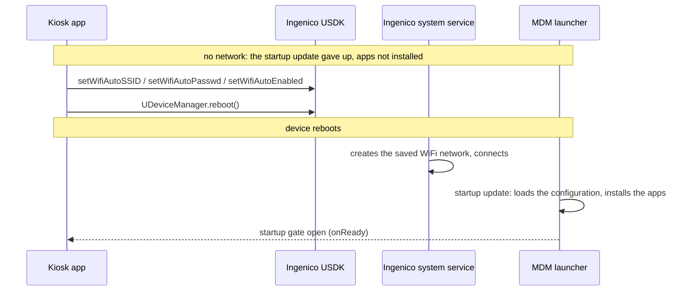

# WiFi setup on Ingenico terminals

How an app configures the WiFi network of an Ingenico terminal without the system settings, why the device has to reboot, and why after the reboot no configuration sync request to the MDM launcher is needed.

## Why

A terminal fresh from the factory has the MDM launcher and the kiosk app installed, but no network: the launcher can't load its configuration, so it can't install the other apps or apply the settings. The network has to be configured from the kiosk app, without sending the user to the system settings.

## What Android allows

On Android 10 (Ingenico EX6000) an ordinary app can no longer add a WiFi network silently. Tested on the EX6000 with an app targeting SDK 34, not device owner (Ingenico's `com.ingenico.dxmobile` is) and not a system app:

| Way | Result |
|---|---|
| `WifiManager.addNetwork()` / `enableNetwork()` | **Refused** (`addNetwork` returns -1): only device owner and system apps may use them with targetSdk 29+. |
| `WifiManager.addNetworkSuggestions()` | Accepted, but Android asks the user to allow the suggestions (notification) and connects when it decides to. The network is removed with the app. |
| `WifiNetworkSpecifier` | The connection belongs to the app only: the launcher can't use it to reach the server. |
| Settings WiFi panel | Works, but it is the system settings screen. |
| **Ingenico USDK "WiFi auto"** | **Works**, at the next boot (see below). |

## Ingenico "WiFi auto"

The Ingenico USDK network manager (`UNetWorkManager`, module `ModuleName.NETWORK_MANAGER`) has a "WiFi auto" setting: a network name and password that Ingenico's system service turns into a saved WiFi network.

```java
UNetWorkManager nm = UNetWorkManager.Stub.asInterface(
        deviceService.getModule(ModuleName.NETWORK_MANAGER, null));
nm.setWifiEnabled(true);
nm.setWifiAutoSSID(ssid);
nm.setWifiAutoPasswd(password);     // WPA/WPA2 personal
nm.setWifiAutoEnabled(true);
```

All calls return 0 on success. The service stores them as `config_wifiauto_SSID` / `config_wifiauto_passwd`.

What happens next:

- **Nothing until the next boot.** Tested: no connection after 60 s, none after turning WiFi off and on.
- **At boot**, while WiFi auto is on, the system service (uid 1000) creates a saved WiFi network with that SSID and password and connects to it. It is an ordinary saved network: it stays if the app is uninstalled.
- **At every boot.** WiFi auto stays on, so the network is recreated at every boot, even after it has been forgotten in the settings. Settings only removes Android's saved network, not Ingenico's setting.
- **To turn it off:** `setWifiAutoEnabled(false)`, and blank the SSID and password (`setWifiAutoSSID("")`, `setWifiAutoPasswd("")`) so the password doesn't stay in the settings. Android's saved network stays (the app can't remove a network created by the system: forget it in the settings).

### Requirements

- **Signing key.** The USDK accepts these calls only from apps signed with an Ingenico-approved key: with it the USDK log shows `isEpayApp: true` and `The permission[titan.extperm.NET_SET] is successfully verified`. The sample app is signed with the launcher's key when the `RELEASE_M10_*` properties are set in `~/.gradle/gradle.properties`; with the debug key the calls fail.
- **USDK library.** `usdk_api_aidl_v13.12.0.20240202.jar` is proprietary and not in this repository: copy it from `app/libs/` of the launcher repo to `app/libs/` (the build says so when it's missing).
- **Manifest:** `titan.extperm.NET_GET` and `titan.extperm.NET_SET`, and `<queries>` for `com.usdk.apiservice`.
- **Network list:** the list of access points uses `WifiManager.getScanResults()`, which on Android 10 needs the location permission and the location turned on. The Ingenico firmware grants the permission at install (`GRANTED_BY_DEFAULT`). Android lets an app scan about 4 times every 2 minutes.

## The reboot is necessary

The settings are applied only at boot, so the app must reboot the device after saving them. The USDK can do it, with the same signing key:

```java
UDeviceManager.Stub.asInterface(deviceService.getDeviceManager()).reboot();
```

The MDM launcher's `reboot` push (`HeadwindMDM.sendPush("reboot", null)`) doesn't work here: the launcher reboots only in device owner mode, and on these terminals it isn't device owner.

## After the reboot no sync request is needed

The reboot also solves the configuration of the MDM launcher, without any request from the app:



- **Without the reboot**, the launcher has already given up: at boot it retries loading the configuration 6 times every 10 s, then ends the startup update. From then on, app installs and removals wait for the next boot (*Install app updates only at device startup*, on by default, see [Startup sync](startup-sync.md)). A sync request (`forceConfigUpdate()`) would load the configuration and apply settings and policies, but leave the apps for the next boot.
- **With the reboot**, the network is there when the launcher starts: the **startup update** loads the configuration and installs the apps like on any boot, and the startup gate holds the kiosk app until they're installed. Nothing for the app to request.

On the EX6000, sample app, launcher just installed, no network:

| Time | Event |
|---|---|
| 11:47:50.068 | Sample app: `WiFi: saving network RUT200_FA74` |
| 11:47:50.282 | `WiFi: network saved, rebooting` (USDK reboot) |
| 11:48:56.873 | At boot the system creates the saved network `RUT200_FA74` and connects |
| 11:49:17 | Launcher: `Configuration updated` |
| 11:49:18–24 | Startup update installs `com.hmdm.pager` |
| 11:49:24.687 | `Startup update completed`, the sample app's gate opens |
| 11:49:29.756 | `Run at boot: started com.mooney.mdm.sample` |

In this test the launcher had been installed through adb and never run, so it was in the stopped state and didn't receive the boot broadcast: the **Start MDM launcher** button started it (see [Starting the MDM launcher](start-launcher.md)). A launcher which has already run, or is preinstalled as a system app, starts by itself at boot.

## Sync request: availability

A sync request is still available for other cases, for example settings changed on the server during the day. The launcher (plugin API, any version since 1.1.5) loads the configuration from the server on request; no API key is needed.

| API | Since | Reports |
|---|---|---|
| `HeadwindMDM.forceConfigUpdate()` | library 1.1.5 | Only whether the request reached the launcher (`getMdmAgentError()`). The launcher then sends the `com.hmdm.push.configUpdated` broadcast at the end of a **successful** update (`onHeadwindMDMConfigChanged()`); nothing on errors. |
| `MDMService.getInstance().forceConfigUpdate(ConfigUpdateListener)` | launcher API 119 (1.1.9) | Progress and result through the listener, on the main thread: `onConfigLoaded()`, `onConfigUpdateComplete()`, `onConfigUpdateError(type, text)` (1 = server, 2 = network, after the retries), app download and install events. Throws `MDMException(ERROR_VERSION)` with an older launcher. |

Rules:

- **Not during the startup update:** it would start a second configuration update in parallel. Call it after the startup gate opened (`onReady()`).
- **During the day** (default configuration option) it applies settings, policies, files and remote commands, but app installs and removals wait for the next boot.
- On a network error the launcher retries 6 times every 10 s before giving up.

The sample app's **Sync configuration** button uses `HeadwindMDM.forceConfigUpdate()`: it is shown once the startup gate is open, and shows "Syncing configuration, please wait" until the launcher's `configUpdated` broadcast, or for at most 90 s, because the launcher sends nothing when the update fails. `ConfigUpdateListener` would report the errors as well.

## Sample app

- **Configure WiFi** (main screen, always shown, not tied to the startup gate): list of access points, network name, password, **Save and reboot**.
- **Reset WiFi auto** (same screen): turns WiFi auto off and clears its network and password. To reproduce a device fresh from the factory: press it, then forget the network in the settings.
- **Sync configuration** (main screen, once the startup gate is open).

Code: `WifiActivity`, `UsdkWifi` (`save()`, `reboot()`, `reset()`, `readStatus()`), `MainActivity.syncConfig()`.
