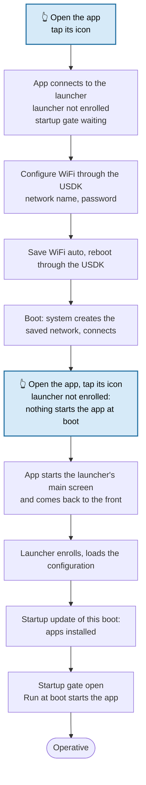
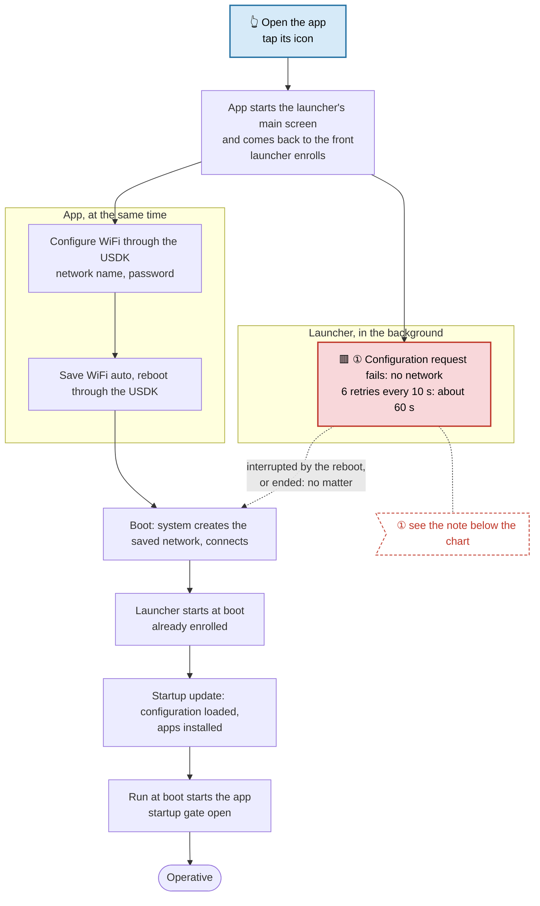
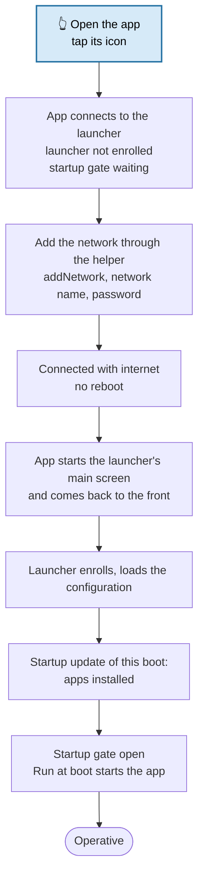
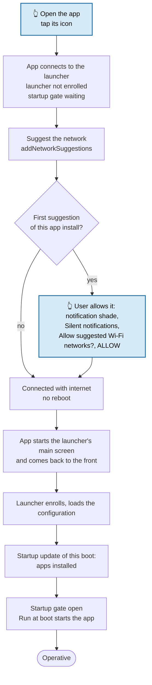

# WiFi setup on Ingenico terminals

How an app configures the WiFi network of an Ingenico terminal without the system settings. Two methods are usable: **Ingenico "WiFi auto"** through the USDK, and **`WifiManager.addNetwork()` from an app targeting SDK 28** (tested on a development terminal; to be confirmed on production terminals). Android **network suggestions** work too, but on Android 10 they aren't usable by a real user. This document describes the three, when each needs a reboot or a configuration sync request to the MDM launcher, the [procedures](#procedures-from-a-new-device-to-operative) from a new device to an operative one (and why not to start the launcher first), and what sync requests are available.

The procedures need MDM launcher **6.54** or later: before its enrollment the launcher keeps its startup update open, so the network can take as long as needed (see [Timeouts](#timeouts)).

## Why

A terminal fresh from the factory has the MDM launcher and the app (for example a payment app) installed, but no network: the launcher can't load its configuration, so it can't install the other apps or apply the settings. The network has to be configured from the app, without sending the user to the system settings.

The terminals are **not in kiosk mode**: the Ingenico launcher is the home screen, the user opens the apps from it and can reach the notification shade, and the MDM launcher works in the background, starting the apps marked *Run at boot* once it has its configuration.

## What Android allows

On Android 10 (Ingenico EX6000) an ordinary app targeting SDK 29 or later can no longer add a WiFi network silently. Tested on the EX6000 with apps which are not device owner (Ingenico's `com.ingenico.dxmobile` is) and not system apps:

| Way | Result |
|---|---|
| `WifiManager.addNetwork()` / `enableNetwork()`, targetSdk 29+ | Refused (`addNetwork` returns -1, log `addOrUpdateNetwork not allowed`): only device owner and system apps may use them. |
| **`WifiManager.addNetwork()` / `enableNetwork()`, targetSdk 28** | **Works**: connects right away, no prompt. See [addNetwork from an app targeting SDK 28](#addnetwork-from-an-app-targeting-sdk-28). |
| `WifiNetworkSpecifier` | The connection belongs to the app only: the launcher can't use it to reach the server. |
| Settings WiFi panel | Works, but it is the system settings screen. |
| **Ingenico USDK "WiFi auto"** | **Works**: connects at the next boot. See [Ingenico WiFi auto](#ingenico-wifi-auto). |
| `WifiManager.addNetworkSuggestions()` | Works, once the user allows it in a silent notification: not usable on Android 10. See [Network suggestions](#network-suggestions). |

## The methods

| | Ingenico WiFi auto | addNetwork, targetSdk 28 | Network suggestions |
|---|---|---|---|
| API | Ingenico USDK `UNetWorkManager` | Android `WifiManager.addNetwork()` | Android `WifiManager.addNetworkSuggestions()` |
| App | any app signed with the Ingenico-approved key | an app targeting SDK 28 or lower (a small helper, see below) | any app |
| Signing key | Ingenico-approved | any (tested with the launcher's key) | any |
| User action | none | none | **Allow** in a silent notification, once per app install |
| Connection | at the next boot: the app reboots the device | right away (4 s in the tests) | right away, a few seconds after the approval |
| Network | ordinary saved network, stays without the app; recreated at every boot while WiFi auto is on | ordinary saved network, kept across reboots; owned by the app: removed if the app is uninstalled; stays forgotten if forgotten in the settings | the **connection is system-wide**; only the **suggestion** belongs to the app (`ephemeral`): removed with the app, kept across reboots |
| Launcher configuration and apps | loaded and installed by the startup update at the reboot | loaded and installed when the app starts the launcher's main screen (launcher 6.54) | as addNetwork, after the approval |
| Status | **tested**, usable | **tested end to end on a development terminal**; production to confirm | tested; **not usable** on Android 10 |

In every case the connection is an ordinary system WiFi connection, used by all apps, the launcher included.

Choose by what fits the deployment: WiFi auto needs the Ingenico key and a reboot, and is applied again at every boot; addNetwork needs neither, but an app targeting SDK 28, which production terminals may not accept (see [Production terminals](#production-terminals)).

## Ingenico WiFi auto

The Ingenico USDK network manager (`UNetWorkManager`, module `ModuleName.NETWORK_MANAGER`) has a "WiFi auto" setting: a network name and password that Ingenico's system service turns into a saved WiFi network.

```java
UNetWorkManager nm = UNetWorkManager.Stub.asInterface(
        deviceService.getModule(ModuleName.NETWORK_MANAGER, null));
nm.setWifiEnabled(true);
nm.setWifiAutoSSID(ssid);
nm.setWifiAutoPasswd(password);     // WPA/WPA2 personal
nm.setWifiAutoEnabled(true);
```

All calls return 0 on success. The service stores them as `config_wifiauto_SSID` / `config_wifiauto_passwd`.

What happens next:

- **Nothing until the next boot.** Tested: no connection after 60 s, none after turning WiFi off and on.
- **At boot**, while WiFi auto is on, the system service (uid 1000) creates a saved WiFi network with that SSID and password and connects to it. It is an ordinary saved network: it stays if the app is uninstalled.
- **At every boot.** WiFi auto stays on, so the network is recreated at every boot, even after it has been forgotten in the settings. Settings only removes Android's saved network, not Ingenico's setting.
- **To turn it off:** `setWifiAutoEnabled(false)`, and blank the SSID and password (`setWifiAutoSSID("")`, `setWifiAutoPasswd("")`) so the password doesn't stay in the settings. Android's saved network stays (the app can't remove a network created by the system: forget it in the settings).

### Requirements

- **Signing key.** The USDK accepts these calls only from apps signed with an Ingenico-approved key: with it the USDK log shows `isEpayApp: true` and `The permission[titan.extperm.NET_SET] is successfully verified`. The sample app is signed with the launcher's key when the `RELEASE_M10_*` properties are set in `~/.gradle/gradle.properties`; with the debug key the calls fail.
- **USDK library.** `usdk_api_aidl_v13.12.0.20240202.jar` is proprietary and not in this repository: copy it from `app/libs/` of the launcher repo to `app/libs/` (the build says so when it's missing).
- **Manifest:** `titan.extperm.NET_GET` and `titan.extperm.NET_SET`, and `<queries>` for `com.usdk.apiservice`.

### The reboot is necessary

The settings are applied only at boot, so the app must reboot the device after saving them. The USDK can do it, with the same signing key:

```java
UDeviceManager.Stub.asInterface(deviceService.getDeviceManager()).reboot();
```

The MDM launcher's `reboot` push (`HeadwindMDM.sendPush("reboot", null)`) doesn't work here: the launcher reboots only in device owner mode, and on these terminals it isn't device owner.

### After the reboot no sync request is needed

The reboot also solves the configuration of the MDM launcher, without any request from the app:


- **Without the reboot** nothing would connect: WiFi auto is applied only at boot. (Where a launcher already enrolled has given up at boot, after 6 retries every 10 s, its startup update is over: app installs and removals wait for the next boot, *Install app updates only at device startup*, on by default, see [Startup sync](startup-sync.md).)
- **With the reboot**, the network is there when the launcher starts: the **startup update** loads the configuration and installs the apps like on any boot, and the startup gate holds the app until they're installed. Nothing for the app to request.

On the EX6000, sample app, launcher just installed, no network:

| Time | Event |
|---|---|
| 11:47:50.068 | Sample app: `WiFi: saving network RUT200_FA74` |
| 11:47:50.282 | `WiFi: network saved, rebooting` (USDK reboot) |
| 11:48:56.873 | At boot the system creates the saved network `RUT200_FA74` and connects |
| 11:49:17 | Launcher: `Configuration updated` |
| 11:49:18–24 | Startup update installs `com.hmdm.pager` |
| 11:49:24.687 | `Startup update completed`, the sample app's gate opens |
| 11:49:29.756 | `Run at boot: started com.mooney.mdm.sample` |

In this test the launcher had been installed through adb and never run, so it was in the stopped state and didn't receive the boot broadcast: the **Start MDM launcher** button started it (see [Starting the MDM launcher](start-launcher.md)). A launcher which has already run, or is preinstalled as a system app, starts by itself at boot.

## addNetwork from an app targeting SDK 28

Android 10 refuses `addNetwork()` only to apps targeting SDK 29 or later: an app targeting SDK 28 can still add a saved network and connect to it, with no prompt and no reboot.

```java
WifiConfiguration conf = new WifiConfiguration();
conf.SSID = "\"" + ssid + "\"";
conf.preSharedKey = "\"" + password + "\"";                 // WPA/WPA2 personal
conf.allowedKeyManagement.set(WifiConfiguration.KeyMgmt.WPA_PSK); // required on Ingenico
int netId = wifiManager.addNetwork(conf);                       // -1 = refused
wifiManager.enableNetwork(netId, true);
```

**Set the key management.** Ingenico's `WifiManager` refuses a configuration without it, before it reaches the WiFi service: `addNetwork` returns -1 and the app's log shows `E/WifiManager: not support type: 0`. Stock Android would infer it from the password; Ingenico's firmware doesn't. (An earlier test without it had been read as a targetSdk refusal.) For an open network: `KeyMgmt.NONE` and no password.

Tested on the EX6000 (development terminal) with a test app, signed with the launcher's key, no saved network in range:

| Test | Result |
|---|---|
| targetSdk 28, `KeyMgmt.WPA_PSK` | `addNetwork` returns the network ID, `enableNetwork` true; connected with validated internet **4 s later**; no prompt, no reboot |
| Reboot | Connected again by itself, validated: an ordinary saved network |
| targetSdk 28, key management not set | Refused in the app: `not support type: 0` |
| targetSdk 34, `KeyMgmt.WPA_PSK` | Refused by Android: `addOrUpdateNetwork not allowed` |
| Uninstalling the app | Android removes the network: `Removing network "RUT200_FA74", application ... uninstalled` |

**The network belongs to the app which added it.** It is removed when that app is uninstalled, and only that app can change or remove it. If the user forgets it in the settings, it stays forgotten (unlike WiFi auto).

**targetSdk 28 for one app only.** The targetSdk applies to the whole app: an app targeting 28 gets the Android 9 behaviour everywhere (storage, background limits, permissions). The payment app should keep its own targetSdk; the WiFi setup goes in a **small helper app** targeting SDK 28, installed with it and kept installed (the network belongs to it), which the payment app opens or calls with the network name and password.

### Production terminals

The tests ran on a **development** terminal (`ro.epay.devmode=1`, `ro.customres.debugmode=true`), with a production-type firmware (`user`, `release-keys`, locked bootloader, verified boot green). Android's rule and Ingenico's key management check are in the firmware, so they should be the same on a production terminal. What is not known:

- whether Ingenico's app validation or signing for production terminals (TEM / RTS, Ingenico-approved key) accepts an APK targeting SDK 28;
- whether the development mode relaxes any WiFi or install check.

To confirm with Ingenico, or by installing the helper on a production terminal through the normal channel. Until then, WiFi auto is the method known to work in production.

## Network suggestions

`WifiManager.addNetworkSuggestions()` is the Android 10 API for ordinary apps: no USDK, any signing key.

```java
WifiNetworkSuggestion suggestion = new WifiNetworkSuggestion.Builder()
        .setSsid(ssid)
        .setWpa2Passphrase(password)           // omit for an open network
        .setIsAppInteractionRequired(true)     // POST_CONNECTION broadcast to the app
        .build();
int status = wifiManager.addNetworkSuggestions(Collections.singletonList(suggestion));
```

Android 10 refuses a suggestion with the SSID of one the app already made: remove the app's suggestions first (`removeNetworkSuggestions()` with an empty list removes them all).

Tested on the EX6000 with a test app, WiFi auto off, no saved network:

| Step | Result |
|---|---|
| `addNetworkSuggestions()` | Accepted (status 0). Android posts the notification "Allow suggested Wi‑Fi networks?" |
| 60 s without approving | Not connected (`dumpsys wifi`: `Has user approved: false`) |
| Approval | The notification is filed under **Silent notifications**, collapsed: the user has to open the notification shade and expand it to see **Allow** / **No thanks** |
| **Allow** tapped (12:57:21.997) | `Has user approved: true` |
| 12:57:29.946 | Connected, 8 s after Allow (`ACTION_WIFI_NETWORK_SUGGESTION_POST_CONNECTION` to the app) |
| 12:57:30.618 | Validated internet (`NetworkCallback`) |
| Reboot | Connected again at about 67 s uptime, without the app running: approved suggestions are kept |

The approval is asked once per app install; later suggestions of the same app connect without it. A reinstalled app (new uid) is asked again.

**Not usable on Android 10.** The only way to approve is that notification: filed under *Silent notifications*, with no sound, no pop-up and no status bar icon, and collapsed, so **Allow** shows only after expanding it. The app can't show the prompt itself, and can't know whether the approval is still pending (`getNetworkSuggestionUserApprovalStatus()` exists only from Android 12). In a test with the sample app the user saw no reaction to **Connect** and didn't find the notification. Suggestions are described here for completeness, and for later Android versions.

**Who can use the connection.** Unlike `WifiNetworkSpecifier`, whose connection is private to the app, a suggestion only allows Android to join the network: the connection is an ordinary system WiFi connection, the device's default network, used by **all apps**, the MDM launcher included (`dumpsys wifi`: `validatedInternetAccess`). After the reboot it reconnected with the suggesting app not running. What belongs to the app is the suggestion itself:

- it is removed when the app is uninstalled or withdraws its suggestions (`removeNetworkSuggestions()`);
- it doesn't appear among the saved networks in the settings (`ephemeral`); if the user disconnects from it or forgets it there, Android stops joining it automatically;
- a network saved by the user, in range at the same time, may be preferred.

### After the connection

The same applies after `addNetwork`. The device is connected without a reboot:

- **Launcher not enrolled yet** (new device): the app starts the launcher's main screen. The launcher enrolls, loads the configuration and installs the apps in this boot (launcher 6.54: its startup update stayed open). A sync request doesn't help here: the launcher isn't enrolled, and the request fails (tested: `network error`, 6 retries).
- **Launcher already enrolled**, startup update over (for example it was enrolled earlier in a boot without network, with launcher 6.53 or earlier, or after the 3 minutes): a **sync request** (see [Sync request: availability](#sync-request-availability)) loads the configuration and applies settings, policies, files and remote commands; the apps wait for the next boot, so **reboot** to install them.

The app waits for the connection with a `NetworkCallback` (`NET_CAPABILITY_VALIDATED`).

Android 11 and later also offer `Settings.ACTION_WIFI_ADD_NETWORKS`, a system dialog which saves the network as an ordinary user network; not available on Android 10.

## Procedures: from a new device to operative

The procedures apply to any app which implements this logic; the sample app is one example (its buttons are given in brackets). WiFi is configured through the Ingenico USDK, through `addNetwork` (targetSdk 28 helper), or through a network suggestion. Starting point:

- the launcher (`com.hmdm.launcher.ingenico`, **6.54** or later) and the app installed, the launcher never run (stopped state);
- no network;
- the app marked *Run at boot* in the configuration; *Install app updates only at device startup* on (default).

**Operative** means: WiFi connected, the launcher enrolled with its configuration loaded, the apps of the configuration installed, the app's startup gate open.

What decides the steps:

- The launcher **enrolls** (reads its enrollment settings, chooses the device ID) only in its main screen: when it is started by hand, or by the app starting its main activity (sample app: **Start MDM launcher**, see [Starting the MDM launcher](start-launcher.md)). Binding to its plugin service (`HeadwindMDM.connect()`) starts its process but doesn't enroll it: `getMdmAgentError()` is `ERROR_NOT_CONFIGURED`.
- The launcher knows which apps to start (*Run at boot*) and install only from its **configuration**, loaded from the server: without a network it has none.
- Apps are installed only by the **startup update**, the first configuration update of a boot. It ends when the configuration is loaded and the apps installed, or when the configuration can't be loaded (6 retries every 10 s, about 60 s), or 3 minutes after it started; after that, apps wait for the next boot. **Before the enrollment** (no configuration ever loaded) the launcher keeps it open: the 3 minutes don't start and a failed request doesn't end it. It runs when the launcher, enrolled, loads its configuration (launcher 6.54).

> 🟦 **Blue blocks, marked 👆: user interaction.** Only two steps need the user: tapping the app's icon (nothing starts it while the launcher has no configuration), and allowing a network suggestion (Android asks the user). The other steps are done by the app by itself: the network name and password, saving and rebooting, adding the network, starting the launcher's main screen. The sample app asks for them through its screen and buttons, but that's the sample's choice.
>
> 🟥 **Red blocks: about 60 s of delay.** Each is marked ① in the chart and explained by the ① note right below it.

In the charts, the blocks in **red** are where the launcher's configuration retries add about **60 s** (6 retries every 10 s with no network). During them the user can go on (the WiFi configuration doesn't wait), but the startup gate stays closed until they end.

### Why not start the launcher first

Starting the MDM launcher first (tapping its icon) on a device without network is not effective:

- **It doesn't start the app.** The launcher enrolls, but it can't load its configuration, so it doesn't know the app is *Run at boot*: the user still has to go to the home screen and open the app by hand to configure WiFi.
- **It adds about 60 s.** Its configuration request is retried 6 times every 10 s; meanwhile the app's startup gate stays closed.
- **Without a reboot, it needs a sync request afterwards.** With launcher 6.54 the failed retries no longer end the startup update (no configuration was ever loaded), but they stop: once the WiFi is connected, something has to ask for the configuration again (a sync request from the app). Not tested. With launcher 6.53 or earlier the failed retries ended the startup update, and the apps waited for the next boot.

The enrollment the launcher needs can be started from the app, without leaving it, at the right moment: before the reboot with the Ingenico USDK ([1, optimized](#1-optimized-wifi-through-the-ingenico-usdk)), after the WiFi connected with `addNetwork` ([2](#2-wifi-through-addnetwork-targetsdk-28-helper)) or a network suggestion ([3](#3-wifi-through-a-network-suggestion)).

### 1. WiFi through the Ingenico USDK



Tested on the EX6000 with the sample app (see the log in [After the reboot no sync request is needed](#after-the-reboot-no-sync-request-is-needed)), with the launcher started 12 s after opening the app. With launcher 6.54 there is no time limit: the launcher, not enrolled, keeps its startup update open until it is started. The optimized chart saves the second tap on the app's icon.

### 1, optimized: WiFi through the Ingenico USDK



> 🟥 **① About 60 s of delay** (red block ① in the chart), but harmless: the launcher's failed configuration requests run **in the background, in parallel** with the WiFi configuration. The user doesn't wait for them: the network can be saved and the device rebooted right away, and the reboot simply interrupts them. They only keep the startup gate closed meanwhile. After the reboot nothing waits.

After the reboot no step depends on the user. With WiFi through the Ingenico USDK, the best procedure is therefore: **start the launcher first** (sample app: **Start MDM launcher**), then **save the network and reboot** (sample app: **Save and reboot**).

### 2. WiFi through addNetwork (targetSdk 28 helper)



No reboot, no sync request, no time limit. Tested end to end on the EX6000 (development terminal), launcher 6.54, the sample app, and a test app targeting SDK 28 for the WiFi step; no saved network in range. The WiFi step was done more than 5 minutes after opening the app, with a sync request tapped in between while there was no network:

| Time | Event |
|---|---|
| 18:02:45 | Sample app opened. Launcher (background): `Startup update awaited before the enrollment, timeout not started` |
| 18:06:14 | The library's 3.5 min safety timeout opens the sample app's gate; the launcher's startup update stays open |
| 18:06:28–18:07:38 | **Sync configuration** with no network: 6 failed retries, then `Startup update kept open: configuration not loaded before the enrollment (network error)` |
| 18:07:51 | Test app (targetSdk 28): `addNetwork` returns the network ID, `enableNetwork` true |
| 18:07:55 | Connected, validated internet |
| 18:08:17 | Sample app: **Start MDM launcher**; the launcher enrolls |
| 18:08:19 | Launcher: `Configuration updated` |
| 18:08:21–26 | Startup update installs `com.hmdm.pager` |
| 18:08:26.911 | `Startup update completed` |
| 18:08:31.950 | `Run at boot: started com.mooney.mdm.sample` |

### 3. WiFi through a network suggestion



The same as procedure 2 once connected, but the approval step makes it [not usable on Android 10](#network-suggestions).

### Timeouts

Three timeouts are involved:

| Timeout | Starts | When it expires |
|---|---|---|
| **Configuration retries**: 6 × 10 s, about 60 s | at each configuration request of the launcher which fails with a network error | the request gives up. If the launcher **has a configuration** (enrolled earlier), the startup update ends and the apps wait for the next boot. If it **never loaded one** (not enrolled yet), the startup update stays open (launcher 6.54). |
| **Startup update**: 3 min | launcher with a configuration: at the first request of the boot (the app's startup gate `awaitStartupUpdate`, or the launcher's own update). Launcher not enrolled: when it, enrolled, first updates the apps (launcher 6.54) | the startup update ends; the apps not installed yet wait for the next boot |
| **Library safety net**: 3 min 30 s | when the app calls `awaitStartupUpdate` | the app's startup gate opens (`STARTUP_TIMEOUT`); the launcher's startup update is not affected |

With launcher 6.54 none of them limits the time spent setting up the network on a new device: while the launcher isn't enrolled there is nothing to install and no payment can be in progress, so the startup update waits for the enrollment. With launcher 6.53 or earlier the 3 minutes started when the app opened, and a failed request before the WiFi connected ended the startup update: the apps then waited for one more reboot.

| Procedure | User steps | Reboot | Status |
|---|---|---|---|
| 1. USDK | open the app twice | 1 | tested |
| 1, optimized | open the app once | 1 | steps tested one by one |
| 2. addNetwork | open the app once | none | **tested end to end** (development terminal) |
| 3. Suggestion | open the app, find and allow the notification | none | tested; not usable on Android 10 |

## Network list

Both methods can show the access points nearby. `WifiManager.getScanResults()` on Android 10 needs the location permission and the location turned on. The Ingenico firmware grants the permission at install (`GRANTED_BY_DEFAULT`). Android lets an app scan about 4 times every 2 minutes.

## Sync request: availability

The launcher (plugin API, any version since 1.1.5) loads the configuration from the server on request; no API key is needed. Useful when the launcher, already enrolled, couldn't load its configuration at boot and the network came later, or when settings changed on the server during the day. Not before the enrollment: the launcher has no device ID yet, and the request fails.

| API | Since | Reports |
|---|---|---|
| `HeadwindMDM.forceConfigUpdate()` | library 1.1.5 | Only whether the request reached the launcher (`getMdmAgentError()`). The launcher then sends the `com.hmdm.push.configUpdated` broadcast at the end of a **successful** update (`onHeadwindMDMConfigChanged()`); nothing on errors. |
| `MDMService.getInstance().forceConfigUpdate(ConfigUpdateListener)` | launcher API 119 (1.1.9) | Progress and result through the listener, on the main thread: `onConfigLoaded()`, `onConfigUpdateComplete()`, `onConfigUpdateError(type, text)` (1 = server, 2 = network, after the retries), app download and install events. Throws `MDMException(ERROR_VERSION)` with an older launcher. |

Rules:

- **Not during the startup update:** it would start a second configuration update in parallel. Call it after the startup gate opened (`onReady()`).
- **During the day** (default configuration option) it applies settings, policies, files and remote commands, but app installs and removals wait for the next boot.
- On a network error the launcher retries 6 times every 10 s before giving up.

The sample app's **Sync configuration** button uses `HeadwindMDM.forceConfigUpdate()`: it is shown once the startup gate is open, and shows "Syncing configuration, please wait" until the launcher's `configUpdated` broadcast, or for at most 90 s, because the launcher sends nothing when the update fails. `ConfigUpdateListener` would report the errors as well.

## Sample app

- See also the [Ingenico Sample App](ingenico-sample-app.md), which does all the steps by itself.
- **Configure WiFi** (main screen, always shown, not tied to the startup gate): setup method, list of access points, network name, password. The sample app targets SDK 28 (1.18 and later), so it offers all three methods. The chosen method is saved (the first time, Android addNetwork is selected):
  - **Android addNetwork** (default): **Connect** adds the network and waits for internet; then, on a new device, **Start MDM launcher** on the main screen. Open networks are allowed. Tested end to end: opened 19:21:00, connected 19:21:46, operative 19:22:46 (launcher 6.54).
  - **Ingenico USDK**: **Save and reboot** saves the network in WiFi auto and reboots through the USDK.
  - **Android suggestion**: **Connect** suggests the network and tells the user where to allow it (notification shade, *Silent notifications*, *Allow suggested Wi‑Fi networks?*, **ALLOW**). When the device is connected with internet the screen offers **Sync configuration** (the main screen requests the sync and waits for it; skipped while the launcher's startup update is still running) and **Reboot** (through the USDK, so the startup update installs the apps). On a new device, with the launcher not enrolled, use **Start MDM launcher** instead: the sync fails before the enrollment. Open networks are allowed (empty password).
  - Where the USDK is not available or refuses the calls (signing key), it can't be selected.
- **Reset WiFi setup** (same screen): removes the networks the app added and its suggestions, and turns WiFi auto off, clearing its network and password. To reproduce a device fresh from the factory: press it, then forget the network in the settings.
- **Sync configuration** (main screen, once the startup gate is open).

Code: `WifiActivity`, `UsdkWifi` (`save()`, `reboot()`, `reset()`, `readStatus()`), `MainActivity.syncConfig()`.
